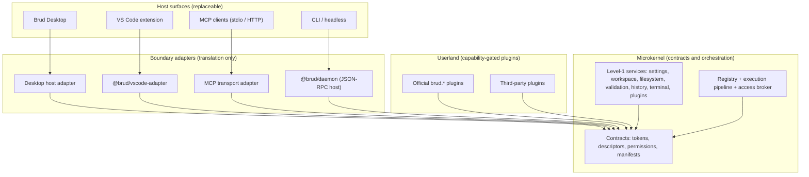
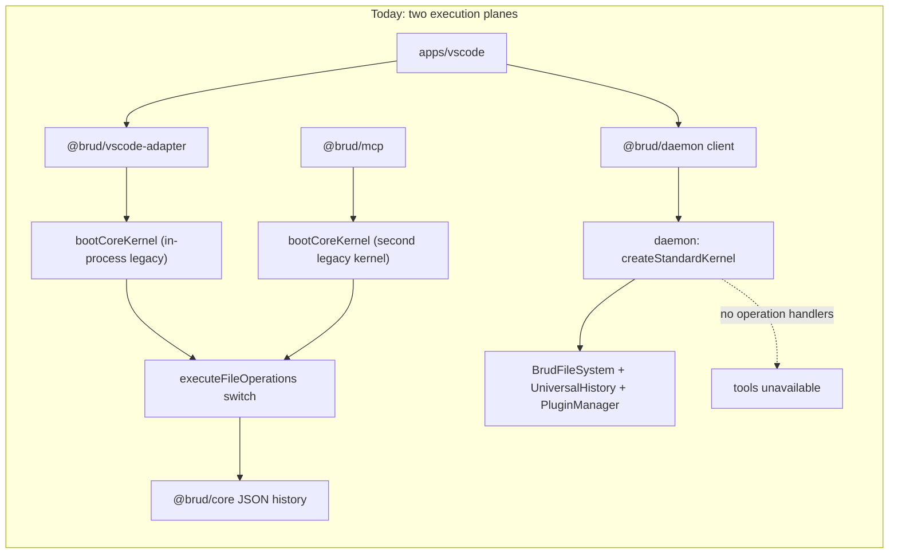
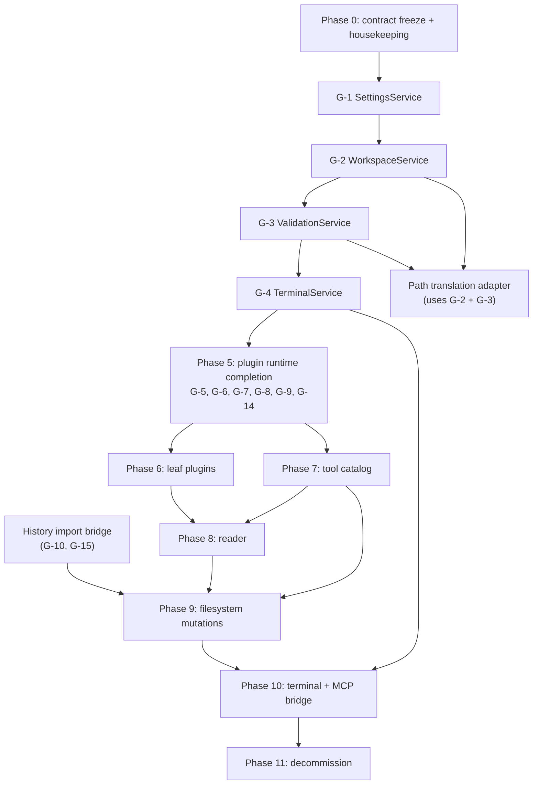
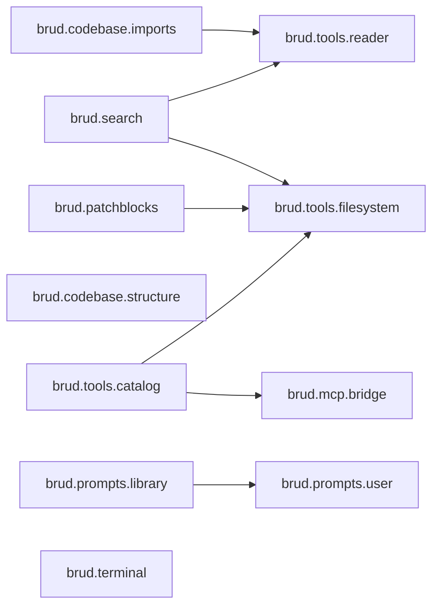
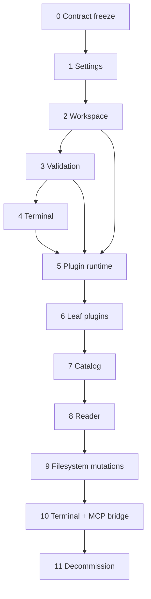

# Brud Core to Microkernel: Internal Architectural Rollout Specification

## Document control

| Field | Value |
|---|---|
| Identifier | `ROLLOUT-0001` |
| Class | Internal engineering plan (single source of truth for the migration) |
| Status | Active / binding for all work that touches execution, filesystem, history, plugins, MCP, or the daemon |
| Owner | Architecture (Akkhar Labs) |
| Supersedes | Ad-hoc migration sequencing in prior task notes |
| Depends on | [BEAS-0001](./ENGINE_ARCHITECTURE_STANDARD.md), [Microkernel Architecture Specification](./microkernel-architecture-spec.md), [MCP Subsystem Design](./mcp-subsystem-design.md), [BrudHistory Specification](./BRUD_HISTORY_ENGINE_SPEC.md) |
| Review cadence | Re-read at the start of every phase; update the phase status table in §5.1 when a phase gate passes |
| Change rule | A behavioural change that contradicts this document must update this document in the same change, citing code and tests. Silent divergence is a defect. |

### Status vocabulary

| Term | Meaning |
|---|---|
| **Enforced** | The invariant is implemented and covered by a named test. |
| **Partial** | Some mechanism exists, but the stated guarantee is not complete. |
| **Missing** | No implementation exists; the gap is scheduled. |
| **Target** | Approved future behaviour; not yet true. |

### Reading order

1. §1 explains *why* the migration is phased and what may not be broken.
2. §2 establishes the *ground truth* of the repository today.
3. §3 lists the prerequisites that block userland plugins.
4. §4 defines the eleven plugins that replace the legacy core.
5. §5 is the executable plan: phases, gates, rollback, and verification.

### Contents

- [1. Executive Summary & Strategic Rationale](#1-executive-summary--strategic-rationale)
- [2. Current Architectural Baseline (What Exists Today)](#2-current-architectural-baseline-what-exists-today)
- [3. Gap Analysis & Prerequisites (What Must Be Addressed)](#3-gap-analysis--prerequisites-what-must-be-addressed)
- [4. Target Plugin Catalog (Deconstruction of Core)](#4-target-plugin-catalog-deconstruction-of-core)
- [5. Step-by-Step Phased Execution Roadmap](#5-step-by-step-phased-execution-roadmap)
- [Appendix A — Frozen Contract Inventory](#appendix-a--frozen-contract-inventory)
- [Appendix B — Parity Test Matrix](#appendix-b--parity-test-matrix)
- [Appendix C — Error Taxonomy Mapping](#appendix-c--error-taxonomy-mapping)
- [Appendix D — Glossary](#appendix-d--glossary)
- [Appendix E — Traceability: Audit Finding to Exit Gate](#appendix-e--traceability-audit-finding-to-exit-gate)
- [Appendix F — Change Control and References](#appendix-f--change-control-and-references)
- [Appendix G — Decision Register](#appendix-g--decision-register)

---

## 1. Executive Summary & Strategic Rationale

### 1.1 The Core Decision

**Brud will ship user-facing value through Brud Desktop first, and migrate the engine to a contract-first microkernel in parallel, incrementally, without a big-bang monolith rewrite.**

The decision is deliberately asymmetric:

- **Product first.** Brud Desktop is the next user-facing surface. It must be able to ship while the engine is still carrying legacy code. No engine purity milestone is allowed to become a release blocker for Desktop.
- **Compatibility first.** Existing surfaces keep working throughout: the VS Code extension, the MCP transports, the daemon JSON-RPC protocol, the `.brud/` on-disk data, and deployments with no third-party plugins.
- **Contracts before plugins.** Work proceeds *outward-in*: harden kernel contracts and Level-1 services, complete the plugin runtime, move features into official plugins, and only then delete legacy code.
- **No mid-session engine swap.** A running workspace keeps one live execution plane. Migration changes are additive registrations behind boot-time flags; cutover happens at a declared boundary (kernel boot or plugin reload), never in the middle of a user session.

In one sentence:

> Brud Desktop is built on today's behaviour; the engine is replaced underneath it one contract at a time, with the legacy path remaining the fallback until parity is proven.

### 1.2 The Product Constraint: Brud Desktop

Brud Desktop is the driver for this plan, not an afterthought. It requires the same capabilities the current hosts need — file reads, file mutations, history and undo, terminal execution, and tool discovery — but with stricter expectations around workspace identity, process lifetime, and multiple open workspaces.

That creates a sequencing rule:

| Requirement | Consequence for the migration |
|---|---|
| Desktop must ship without waiting for a full engine rewrite | The legacy `executeFileOperations` path stays available until Phase 11. |
| Desktop owns a long-lived process | The kernel and Level-1 services must be host-neutral and bootable in the daemon, not only inside VS Code. |
| Desktop may open more than one workspace | Workspace identity must become a first-class Level-1 concern before plugins are trusted with paths. |
| Desktop must not regress existing users | Every phase must preserve operation semantics, error codes, and on-disk history compatibility. |
| Desktop is a new surface, not a fork | It consumes the same protocol and kernel contracts as VS Code and MCP. No Desktop-only execution logic. |

**Non-negotiable:** no migration phase may require a data migration window in which the user cannot execute operations, and no phase may invalidate an existing `.brud/history` directory.

### 1.3 The Inward-Dependency Microkernel Principle

The target architecture is defined by the direction of dependencies, not by the number of packages.



The principle has five binding rules.

| Rule | Statement | Why it matters |
|---|---|---|
| **R1 — Contracts own types** | Every type a plugin can see is declared in `@brud/kernel` contracts. Plugins never import `@brud/core`, `@brud/mcp`, an adapter, or an app. | A plugin compiled against kernel contracts cannot acquire legacy lock-in. |
| **R2 — Kernel has no outward knowledge** | `@brud/kernel` never imports userland, transports, or hosts. | The kernel can boot in Desktop, VS Code, a daemon, or a test process unchanged. |
| **R3 — Access is projected** | A service instance is never handed to a caller. The access broker projects it per caller tier, permissions, and partition. | Read-only callers cannot mutate; plugins cannot reach raw drivers. |
| **R4 — Transports are replaceable** | stdio, HTTP, JSON-RPC, and future Desktop IPC are adapters over `tools:execute`, not executions of their own. | Replacing a transport cannot change security or semantics. |
| **R5 — Removal is reversible at the edge** | Any adapter can be deleted without losing domain logic. | Host churn (VS Code → Desktop) does not become engine churn. |

**Zero-downtime execution** in this document means the operational property implied by R1–R5: the workspace kernel and its state stay alive while surfaces attach, detach, or change transport. It does **not** promise hot-patching a running process. A migration cutover is a controlled boot or plugin reload; it is never a mid-operation replacement of the execution engine.

**Avoiding legacy lock-in without a rewrite:** the legacy core is treated as an *implementation detail behind a compatibility facade*. The facade translates legacy absolute paths and result envelopes into kernel-relative calls and back. When the last plugin owns the last operation kind, the facade and the code behind it are deleted. At no point does a plugin depend on the facade.

### 1.4 Why Phased Migration Over Immediate Cutover

A big-bang cutover was evaluated and rejected. The audit trail exposes seven blocking risks that make a single cutover unsafe.

#### Risk register

| ID | Audit finding | Evidence in the repository | Blast radius if cut over now | Retired by |
|---|---|---|---|---|
| **R1** | **21 entangled tool handlers.** All operation kinds share one 1,719-line switch and cross-cutting state (`pathCache`, pre-snapshots, batch read maps, metadata, search results, history session merge). | `packages/core/src/file-operations/index.ts` (`executeFileOperations` at line 186; dispatch switch begins line 242); `packages/core/src/bridge/legacyBridge.ts:15-21` enumerates 21 kinds. | Every tool breaks at once; a regression in one kind is indistinguishable from a regression in the dispatch layer. | Phases 6–10 |
| **R2** | **Divergent path models.** Legacy core accepts absolute paths, supports multiple workspace folders, and canonicalizes with `realpath`. Kernel files are workspace-relative, single-root, and now reject absolute paths even when inside the root. | `packages/core/src/utils/workspacePath.ts`, `packages/core/src/utils/pathResolver.ts`, `packages/core/src/api/index.ts`; `packages/kernel/services/BrudFileSystem/validation/PathValidator/PathValidator.ts` (`resolveContained`, line 208); semantic audit `2026-10-24_kernel_pathvalidator_semantic_boundary_audit.md`. | Silent behaviour change for every MCP client and extension caller: paths that used to work become `PATH_TRAVERSAL_DETECTED`. | Phase 2 (WorkspaceService + path adapter) and Phase 3 (ValidationService) |
| **R3** | **Dual kernels, one unbooted.** MCP builds a legacy kernel through `bootCoreKernel` without calling `boot()`; the daemon builds a standard kernel with no operation handlers. | `packages/mcp/src/bootstrap.ts:93-103`; `packages/core/src/bridge/legacyBridge.ts:92-118`; `packages/daemon/src/kernelRuntime.ts:17-25`; `packages/daemon/src/server/dispatch.ts` (fs/history methods only). | A third execution plane appears; security and history semantics differ by entry point. | Phase 10 |
| **R4** | **Session history divergence.** Legacy history is JSON session folders; UniversalHistory is an SQLite ledger with CAS blobs, reversal plans, and different ID allocation. | `packages/core/src/history/store.ts`; `packages/adapters/vscode/src/historyStore.ts`; `packages/kernel/services/UniversalHistory/` (`SqliteLedger`, `commitSession.ts`, `planReversal.ts`). | Two ledgers record the same transaction differently; undo can point at the wrong store; retention diverges. | Phase 9 (with import bridge) |
| **R5** | **Global singletons and ambient state.** The tool catalog is a module singleton; operation IDs use a module counter; MCP wraps settings in a mutable `Proxy`; legacy tokens are module-local symbols. | `packages/core/src/tool-registry/registry.ts:17` (`globalToolRegistry`); `packages/core/src/file-operations/index.ts:43` (`operationIdCounter`); `packages/mcp/src/bootstrap.ts:26-44`; `packages/core/src/bridge/tokens.ts`. | Multiple Desktop workspaces or concurrent kernels share catalog and ID state; tests cannot isolate. | Phases 5–7 |
| **R6** | **Incomplete plugin capability surface.** `IPluginContext` exposes only filesystem and history. Five target capabilities have no handle: three are declared permissions (`tools:register`, `tools:execute`, `telemetry:emit`) and two are not yet in the union (`settings:read`, `terminal:execute`). | `packages/kernel/services/PluginManager/contracts/IPluginContext.ts`; `permissions.ts` (`PluginCapability` lists only `fileSystem` and `universalHistory`). | Plugins cannot own tools, terminal, settings, or telemetry; extraction would leave half the logic in core. | Phase 5 |
| **R7** | **Security projection gap.** Filesystem has `ReadOnlyFacade`; history has no read-only facade. Plugin activation also happens while the kernel is `BOOTING`, when the broker refuses grants. | `packages/kernel/services/BrudFileSystem/projection/ReadOnlyFacade/ReadOnlyFacade.ts`; `packages/kernel/src/engine/KernelAccessBroker.ts:29-32`; `PluginManagerService.initialize()` → `activateAll()`. | A `history:read` plugin receives the full mutation API; any plugin requesting a facade during boot fails. | Phase 5 |

#### Decision matrix

| Criterion | Big-bang cutover | Phased migration (chosen) |
|---|---|---|
| Time to Desktop value | Blocks until the entire engine is replaced | Desktop ships on the stable legacy path while contracts harden |
| Failure locality | Any defect can affect all 21 kinds simultaneously | One plugin/phase at a time; flags isolate blast radius |
| Path/security regression risk | High: two path models change atomically | Managed by WorkspaceService + translation adapter + parity suite |
| History data safety | High: two stores must be reconciled in one step | One-way idempotent import, legacy files retained through Phase 11 |
| Reversibility | Git revert of a huge diff | Flag flip to legacy path at a declared boundary |
| Testability | Requires a complete new test matrix before any merge | Parity fixtures accrue per plugin; each phase has its own gate |
| Cognitive load on contributors | Must understand the entire old and new engine at once | One contract or one plugin per phase |

**Conclusion:** the phased path is slower only in calendar time; it is faster to a safe Desktop release, and it is the only path that keeps the MCP and VS Code surfaces trustworthy during the transition.

### 1.5 Success Criteria

| Dimension | Criterion | Measured by |
|---|---|---|
| Product | Brud Desktop ships without waiting for Phase 11 | Release independent of migration status |
| Behavioural parity | All 21 operation kinds produce equivalent results and error codes through the plugin path | Golden fixture suite (§5.5, Appendix B) |
| Data safety | No loss of `.brud/history` sessions; every reverted session resolves to its original bytes | Reversal parity tests; import dry-run |
| Security | No plugin reaches a service or driver without a declared permission; no absolute path reaches a driver | Capability denial matrix; path parity matrix |
| Isolation | No shared mutable singleton across kernels | Static check + concurrent kernel tests |
| Host neutrality | The same kernel boots in daemon, MCP, Desktop, and test hosts | Bootstrap suite |
| Operability | Every phase is reversible by configuration until Phase 11 | Rollback table in §5.6 |
| Decommission | Zero references to legacy execution symbols after Phase 11 | `rg` gate + boundary check |

### 1.6 Non-Goals

The following are explicitly out of scope for this rollout. They must not be smuggled into a phase.

- Process-level sandboxing of plugins (worker threads, `vm`, OS sandboxes). Phase 5 delivers **capability projection** — that is the sandbox this rollout claims — not hostile-code isolation. A future ADR owns process isolation.
- A new UI, a new design system, or Desktop-specific visual work.
- Changing the daemon JSON-RPC wire contract or the MCP tool names.
- Changing user-visible operation semantics (for example, making `create_file` overwrite by default).
- Multi-user or remote-server execution.
- A telemetry vendor decision. Phase 5 defines a sink contract only.
- Rewriting the history engine. UniversalHistory is adopted; the legacy history is retired, not merged feature-for-feature.
- Deleting `.brud/history/sessions` or rewriting user files during import.

---

## 2. Current Architectural Baseline (What Exists Today)

### 2.1 Package Topology

| Package | Role today | Relationship to the target |
|---|---|---|
| `packages/kernel` | Zero-Node microkernel: service container, descriptors, access broker, operation registry, execution pipeline, DAG boot, Level-1 `BrudFileSystem`, `UniversalHistory`, `PluginManager` | Becomes the only execution contract owner |
| `packages/core` | Platform-agnostic legacy engine: parser, 21-kind operation switch, JSON history, terminal spawn, search, read engine, structure/metadata extractors, prompt library, tool registry, settings, validation, legacy bridge | Dismantled into official plugins; residual pure code moves to owners |
| `packages/protocol` | Daemon JSON-RPC wire contracts | Unchanged; remains the daemon boundary |
| `packages/daemon` | Long-lived workspace host: standard kernel (fs/history/plugin manager), JSON-RPC server, lifecycle, lock, idle shutdown | Gains operation handlers and the full Level-1 service set; remains the single long-lived kernel per workspace |
| `packages/mcp` | Standalone MCP transport: bootstrap, catalog, normalize, dispatch, HTTP, stdio, limits, CLI | Becomes `brud.mcp.bridge` over `tools:execute`; stops booting a legacy kernel |
| `packages/adapters/vscode` | VS Code filesystem/terminal/settings/prompt adapters; `executeOperationsFromVSCode` boots the legacy core kernel | Becomes a thin protocol client; execution moves to the daemon |
| `apps/vscode` | Extension entry, providers, webview, MCP lifecycle panel | Stays a host surface; loses execution logic |
| `packages/ui`, `apps/web` | Webview UI and marketing site | Out of scope |



### 2.2 Boot Topology

`createStandardKernel()` registers exactly three descriptors:

| Order | Descriptor | Token | Dependencies | Lifecycle |
|---|---|---|---|---|
| 1 | `createFileSystemDescriptor` | `brud.core.filesystem` | none | `initialize()` creates the root directory; `dispose()` clears keyed write tails |
| 2 | `createUniversalHistoryDescriptor` | `brud.core.universalHistory` | filesystem | Lazy filesystem access; SQLite ledger opened at first use |
| 3 | `createPluginManagerDescriptor` | `PluginManager` | filesystem, history (when `withUniversalHistory`) | `initialize()` activates plugins; `dispose()` deactivates in reverse |

`BrudKernel.boot()` performs the sequence below (`packages/kernel/src/engine/BrudKernel.ts`):

```text
UNINITIALIZED
  |  register(descriptor) x N        (rejected unless UNINITIALIZED)
  v
BOOTING
  |  registry.freeze()
  |  topologicalSort(descriptors)
  |  for each descriptor:
  |      factory(context, broker)
  |      registry.setInstance(token, instance)
  |      instance.initialize(broker)     <- plugins activate here
  v
RUNNING
  |  access broker grants begin here
  |  execution pipeline accepts calls
  v
SHUTTING_DOWN
  |  initialized services in reverse order
  |  dispose() each, first error preserved, all attempted
  v
DISPOSED
```

Two consequences matter for the rollout:

1. **Deterministic order is structural.** It comes from descriptor `dependencies` plus `topologicalSort`, not from registration order. Adding Settings/Workspace/Validation/Terminal changes the graph, not the boot mechanism.
2. **Grant timing is currently wrong for plugins.** `PluginManagerService.initialize()` calls `activateAll()` while the kernel is still `BOOTING`, but `KernelAccessBroker.requestAccess()` refuses anything except `RUNNING`. A plugin that calls `context.getFileSystem()` during `activate()` fails at boot. The current bootstrap test plugins do not request a facade, so the defect is latent. Phase 5 fixes it.

### 2.3 Hardened Kernel Services (Level-1)

#### Level-1 register

| Service | Token | Tier | Contract | Status |
|---|---|---|---|---|
| Filesystem | `brud.core.filesystem` | core | `IBrudFileSystem` | Enforced |
| Universal history | `brud.core.universalHistory` | core | `IUniversalHistoryService` | Enforced |
| Plugin manager | `PluginManager` | core | `IPluginManagerService` | Enforced (token naming is legacy) |
| Settings | — | — | — | Missing (Phase 1) |
| Workspace | — | — | — | Missing (Phase 2) |
| Validation | — | — | — | Missing (Phase 3) |
| Terminal | — | — | — | Missing (Phase 4) |
| Telemetry | — | — | — | Missing (Phase 5, sink only) |

#### 2.3.1 `BrudFileSystem` (`brud.core.filesystem`)

**Contract:** `IBrudFileSystem` exposes `readFile`, `readText`, `writeAtomic`, `createFile`, `deleteFile`, `readDirectory`, `stat`, `exists`. Paths are **workspace-relative**. Absolute paths are accepted only when `WorkspaceService` proves they resolve strictly inside the canonical workspace root; every other absolute path is rejected.

**Implementation:** `BrudFileSystem` delegates all containment and canonicalization to `WorkspaceService.resolveContained` and is the only path from userland to an `IStorageDriver`. `PathValidator` remains the lexical guard inside `ScopedPartitionFacade`; it is not a substitute for workspace containment.

| Mechanism | Implementation | Invariant | Evidence |
|---|---|---|---|
| Ambient validation | Every public operation resolves the caller path through `WorkspaceService.resolveContained` before any driver call; generated staging paths are resolved again | No driver call without workspace validation | `orchestrator/BrudFileSystem.ts` |
| Canonical containment | `WorkspaceService` resolves the real root and nearest existing real ancestor, then performs a segment-aware boundary and symlink check | Symlink escape is rejected; non-existent create targets still work | `services/WorkspaceService/` |
| Root write rejection | `writeAtomic` / `createFile` reject `''`, `'.'`, and existing directories with `PATH_VIOLATION` or `CANNOT_WRITE_DIRECTORY` | Staging can never run against the workspace root | `orchestrator/BrudFileSystem.ts` |
| Secure staging | Unique sibling name `.${basename}.${pid}.${uuid}.tmp`, created with `O_CREAT` + `O_EXCL` + `O_WRONLY`; a pre-existing file or symlink fails closed | Predictable `<path>.tmp` collisions and symlink following are impossible | `operations/shared/staging.ts`, `drivers/node/NodeStorageDriver/` |
| Atomic staged writes | Staging file flushed, then `rename`; readers observe the old or the new complete file | No partial content is ever visible | `operations/write_atomic/writeAtomic.ts` |
| Cross-process concurrency | Every writer has a private staging file; `rename` provides last-writer-wins without tearing. `createFile({ overwrite: false })` publishes with an atomic `link`, so exactly one creator wins | Concurrent instances and processes cannot corrupt or spuriously fail a shared target | `operations/write_atomic/writeAtomic.ts`, `operations/create_file/createFile.ts` |
| Metadata preservation | Existing file `mode` is read before staging and applied with `chmod` before publication; new files default to `0o644` | Executable scripts stay executable across rewrites | `orchestrator/BrudFileSystem.ts`, `drivers/DurableNodeStorageDriver.ts` |
| Mutation journal | Non-blocking journal: descriptors publish only after staging succeeds and before publication, and listeners run in a queued microtask. A post-rename `fsync` failure emits `committed_with_durability_warning` and throws an error with `committed: true` | No phantom history for failed writes; a slow or failing history sink cannot fail or delay a mutation; committed-but-not-durable is never reported as failure | `events/`, `orchestrator/BrudFileSystem.ts` |
| Startup staging sweep | `initialize()` removes `.${basename}.${pid}.${uuid}.tmp` files whose owner is gone or older than one hour, reporting failures to the logger | Orphan temporary files cannot accumulate or be mistaken for user files | `operations/shared/staging.ts` |
| Protected-path denylist (A10) | The A10 denylist gates **write, mutate, and delete** operations on `.brud/settings.json`, `.brud/history/**`, and `.git/**`; every such attempt fails with `PROTECTED_PATH_DENIED`. Only the history subsystem receives a `.brud/history` write capability through its descriptor projection. **Reading history entries is not denied by A10**: it is governed by the `HistoryToken` access policy (`AccessPolicy` + tier projection), which returns the full service to `tier: 'core'` callers and a read-only facade to everyone else | Plugins cannot rewrite policy, history, or git metadata, while history reads remain available through the audited contract rather than the raw filesystem | `security/protectedPaths.ts`, `descriptor/descriptor.ts`, `UniversalHistory/descriptor/HistoryDescriptor.ts` |
| Tier projection | Raw writable handles are reserved for `tier: 'core'`; kernel and userland callers receive a scoped or read-only projection. The descriptor declares an explicit `accessPolicy` | A lower-trust caller cannot obtain an unrestricted writable filesystem | `descriptor/descriptor.ts`, `projection/` |
| CAS blob staging | UniversalHistory commits content-addressed blobs through this service's `writeAtomic` into the blob store under `.brud/history/blobs/` using its granted history scope (see the layout note below) | Blob commits inherit atomic staging and per-path serialization; duplicate digests are idempotent | `UniversalHistory/operations/commit_session/commitSession.ts`, `UniversalHistory/storage/SqliteHistoryStorage.ts` |
| Per-path serialization | `KeyedWriteMutex` around every mutating call | Two writers in one instance cannot interleave on the same absolute path | `concurrency/KeyedWriteMutex/KeyedWriteMutex.ts` |
| Driver portability | `IStorageDriver` implemented by the durable Node driver and the in-memory driver; optional exclusive-create, link, chmod, and flush capabilities | The service stays Node-free while the production driver provides POSIX guarantees | `drivers/contracts/IStorageDriver/`, `drivers/DurableNodeStorageDriver.ts` |

**Clarification of terminology.** `BrudFileSystem` provides atomic *staged* writes. Content-addressed (CAS) blob commits are a **UniversalHistory** feature that stages blobs through `writeAtomic` into the history blob store. Do not describe `writeAtomic` as compare-and-swap: it is not.

**History blob layout and payload threshold.** The journal-driven ledger (`brud.core.history`) stores payloads under a flat, content-addressed layout:

```
.brud/history/
  history.db            # SQLite ledger (WAL, busy_timeout = 5000 ms)
  blobs/<sha256>        # offloaded payload, named by its lowercase hex digest
```

The decision is size-based, not kind-based:

| Payload size | Storage | Ledger reference |
|---|---|---|
| `<= 65,536` bytes (64 KiB) | Inlined in `mutations.inline_data` / `contents.inline_data` | `blob_ref` is `NULL` |
| `> 65,536` bytes (64 KiB) | Offloaded to `.brud/history/blobs/<sha256>` | `blob_ref = '.brud/history/blobs/<sha256>'` |

The threshold is exported as `INLINE_SNAPSHOT_LIMIT_BYTES`. Blob bytes are re-hashed on every read; a digest mismatch raises `BlobIntegrityError` (`BLOB_DIGEST_MISMATCH`) and the bytes are never replayed into the workspace. The legacy session ledger (`SqliteLedger` / `commitSession`) uses a sharded `<first-2>/<sha256>` layout; the journal-driven ledger documented here is flat.

**Known limits (target for later phases):**

- No `rename`, `copy`, `createDirectory`, or `deleteDirectory` in `IBrudFileSystem`. Directory removal and moves are currently performed inside the legacy switch. `brud.tools.filesystem` cannot be extracted without these primitives (G-7).
- Single root per instance. Multi-root identity belongs to WorkspaceService (Phase 2).
- No canonicalization cache. The audit's A8 remains open; Phase 2 adds a batch-scoped cache.
- Caller-declared `tier` and `callerId` remain forgeable until the kernel mints `ServiceContext` (audit A5). Projection is therefore defense in depth, not caller authentication.
- No operation metadata on errors; the adapter supplies `operationKind` when mapping to legacy results.

#### 2.3.2 `UniversalHistory` (`brud.core.universalHistory`)

**Contract:** `IUniversalHistoryService` exposes `beginSession`, `commitSession`, `planReversal`, `executeReversal`, `getSession`, `listSessions`.

**Implementation:** `UniversalHistoryService` composes a SQLite ledger, a lazily resolved `BrudFileSystem`, and an `IdAllocator`.

| Property | Implementation | Evidence |
|---|---|---|
| Durable state ledger | SQLite at `.brud/history/ledger.db`; WAL where supported; foreign keys ON; `synchronous = NORMAL` | `storage/SqliteLedger/schema.ts` |
| ACID session commit | `BEGIN IMMEDIATE` transaction around session status and all file rows; rollback on error | `storage/SqliteLedger/SqliteLedger.ts` |
| CAS blob store | SHA-256 content addressing at `.brud/history/blobs/<first-2>/<sha256>` for the session ledger, `.brud/history/blobs/<sha256>` for the journal ledger; digest verified before write and re-verified on every read | `operations/commit_session/commitSession.ts`, `storage/SqliteHistoryStorage.ts` |
| Baseline capture | Declared targets are captured before mutation; digest + bytes/text; no whole-tree snapshot | `operations/capture_baseline/` |
| Forward deltas | Only changed targets produce rows; binary payloads carry a blob digest | `operations/compute_delta/` |
| Reversal planning | Pure plan with conflict detection against current SHA-256; `executeReversal` applies it | `operations/plan_reversal/`, `operations/execute_reversal/` |
| Rollback journal | `reversals` table records target state, status, reverted operations, and error | `storage/SqliteLedger/schema.ts` |
| Session identity | `BR-YYYYMMDD-NNN` with a per-day sequence persisted in `.brud/history/seq.json` (UTC) | `storage/IdAllocator/`, `contracts/IUniversalHistoryService/types.ts` |
| Path scoping | All service paths are workspace-relative and flow through `IBrudFileSystem` | Descriptor wiring in `descriptor/UniversalHistoryDescriptor.ts` |

**Known limits:**

- No invocation provenance. A machine-invoked write and a human-invoked write are indistinguishable (MCP divergence D6).
- File-level model only. Directory rename/delete is represented as per-file operations; empty-directory state is not captured.
- Retention is data-only (`expiresAt`, soft-delete flags); no background enforcement loop exists.
- No read-only projection. Any caller that can resolve the token can mutate (G-8).
- No abort-with-rollback path. `commitSession('aborted')` finalizes without file rows, so a partially applied batch has no ledger-based reversal plan (G-17).
- Legacy JSON sessions are not imported. Phase 9 adds a one-way importer.

**Journal ledger hardening (journal-driven `brud.core.history`).** The Phase 4 reversal engine adds the following guarantees to the store above:

| Property | Implementation | Evidence |
|---|---|---|
| Content-addressed integrity | Every blob read re-computes SHA-256 and fails with `BlobIntegrityError` on mismatch; inline payloads are re-hashed before replay | `storage/SqliteHistoryStorage.ts` |
| All-or-nothing reversal | Undo, redo, and checkpoint rollback pre-flight **every** pre-image in the batch before writing; a missing or corrupted payload returns `payload_missing` / `payload_corrupt` with zero disk writes | `engine/RollbackEngine.ts` |
| Frozen cursor on failure | `undo_cursor` advances only when a batch ends `success`; `partial`, `drift_aborted`, `payload_*` leave it untouched | `engine/RollbackEngine.ts` |
| Atomic ingestion | Content insert, redo-tail truncation, mutation insert, and cursor upsert share one `BEGIN IMMEDIATE` transaction | `storage/SqliteHistoryStorage.ts` |
| Multi-process safety | `PRAGMA busy_timeout = 5000` so concurrent writers queue instead of failing with `database is locked` | `storage/SqliteHistoryStorage.ts` |
| Degraded read-only boot | `SQLITE_READONLY` / `EACCES` / `EPERM` during open or WAL setup degrades the service: boot succeeds, ingestion is a no-op, reversals throw `HistoryDegradedError` | `storage/SqliteHistoryStorage.ts`, `descriptor/HistoryDescriptor.ts` |
| Ingestion telemetry | Background journal failures are forwarded to `context.logger?.warn(...)` instead of being swallowed | `listener/JournalSubscriber.ts`, `descriptor/HistoryDescriptor.ts` |

#### 2.3.3 `PluginManager` (`PluginManager`)

**Contract:** `IPluginManagerService`, `IBrudPlugin`, `IPluginContext`, `PluginManifest`.

| Mechanism | Implementation | Invariant |
|---|---|---|
| `OFFICIAL_PLUGIN_BRAND` (unforgeable official brand) | Module-local `unique symbol`; `certifyOfficialPlugin` defines a non-enumerable, non-configurable, non-writable own property; `hasOfficialPluginBrand` checks the exact own descriptor | A manifest cannot manufacture official status |
| Reserved namespace (`brud.*`) | The `brud.` and `@brud/` id prefixes are rejected without a genuine brand | Third parties cannot impersonate first-party plugins |
| Manifest validation | `validatePluginManifest` returns structured failure reasons: `INVALID_MANIFEST`, `RESERVED_NAMESPACE`, `OFFICIAL_STATUS` | Untrusted input is validated before registration |
| Dependency DAG | `resolveActivationOrder` performs a stable topological sort; cycle detection throws `PluginDependencyError` | Activation order is deterministic |
| Fail-fast activation rollback | `activateAll` tracks activated plugins and rolls them back in reverse on failure; the failing record becomes `failed` | A partially activated graph never remains live |
| Dynamic lifecycle | `activatePlugin` / `deactivatePlugin` with active-dependent guards; `deactivateAll` runs in reverse activation order | Plugins can be added and removed at runtime |
| Scoped context | `PluginContext` memoizes facades, checks permission requirements, throws `PluginPermissionError` with required permissions | No raw service or broker is exposed |
| Disposal ordering | `PluginSubscriptions.disposeAll` releases in reverse registration order, attempting every disposable once | Resources are released deterministically |

The `OFFICIAL_PLUGIN_BRAND` symbol is declared only in kernel source and is absent from every public barrel. Official status is therefore a compile-time capability of first-party code and a runtime-verified property, never a manifest assertion.

**Known limits:**

- `IPluginContext` exposes only `getFileSystem()` and `getUniversalHistory()` (G-5, G-6).
- Activation occurs during `BOOTING`, before broker grants (G-9).
- The logger writes to `console`, which is a host leak; Phase 5 routes it to a telemetry sink.
- Plugin history access resolves the legacy `brud.core.universalHistory` token, not the Phase 4 `brud.core.history` audit surface. The A10 denylist gates only **write, mutate, and delete** operations on `.brud/history/**` (`PROTECTED_PATH_DENIED`); it does **not** gate reads. Entry-level reads of the audit surface are governed by the `HistoryToken` access policy (core tier receives the service, every other tier receives `ReadOnlyHistoryFacade`). Plugins must never read `history.db` or the blob files through raw filesystem reads.
- Capability projection is not process isolation. See §1.6.
- No on-disk discovery, lazy module loading, or persistence of failure state across restarts.
- History facade is the full service; there is no read-only projection (G-8).
- The service token identifier is `PluginManager`, not namespaced. It is frozen until Phase 11 to avoid churn (G-12).

**Lifecycle states:** `unloaded` → `activating` → `active` → `deactivating` → `unloaded`; failures land in `failed` with a recorded message.

#### 2.3.4 `createStandardKernel()` Bootstrap

| Property | Current behaviour | Target behaviour |
|---|---|---|
| Registered services | Filesystem, History, PluginManager | Settings → Workspace → Filesystem → History → Validation → Terminal → Telemetry → PluginManager |
| Operation handlers | None | All official plugin tools registered |
| Plugin activation | During `PluginManager.initialize()` while `BOOTING` | After `RUNNING` via an explicit post-boot hook |
| Shutdown | Reverse order, all disposals attempted, first error surfaced | Same, plus plugin deactivation before filesystem disposal (already enforced by tests) |
| Workspace root | Passed to `boot()`; used by descriptors | Canonicalized by WorkspaceService before descriptors consume it |
| History degraded boot | Read-only `.brud/history` degrades the journal ledger: boot succeeds, ingestion is a no-op, reversals throw `HistoryDegradedError`, and a `HISTORY_DEGRADED` warning reaches the logger | Same |
| Diagnostic sink | `KernelBootOptions.logger` / `CreateStandardKernelOptions.logger` is forwarded to `ServiceContext.logger`; history ingestion failures warn through it (console fallback) | Phase 5 telemetry sink |

The bootstrap's deterministic order and reverse shutdown are already correct and must not be weakened.

### 2.4 Configuration & Policy Decisions

#### Decision: raw JSON configuration is a Level-1 service

**Decision D-2:** Engine policy is stored as raw JSON, not SQL. User scope lives at `~/.brud/settings.json`; workspace scope lives at `<workspace>/.brud/settings.json`.

Why JSON wins for this problem:

| Criterion | Raw JSON | SQLite |
|---|---|---|
| Human editability | Directly editable; comments-free but obvious schema | Requires a client or query |
| Git versioning | Workspace file diffs and reviews naturally | Binary file; poor diffs and merge conflicts |
| Process concurrency | Atomic replace + read-only snapshots; readers never block | Requires connection management, WAL, locking, migrations |
| Desktop UI simplicity | Parse, validate, render a form; write atomically | Needs a query layer and migration strategy |
| Failure recovery | A malformed file falls back to defaults with a warning | Corruption requires recovery tooling |
| Boot determinism | A frozen snapshot is trivial to produce | Transactions and schema versioning add boot complexity |

**Precedence (target):**

```text
DEFAULT_SETTINGS
  < host global settings (VS Code global)        [compatibility input; removed in Phase 11]
  < host workspace settings (VS Code workspace) [compatibility input; removed in Phase 11]
  < ~/.brud/settings.json (user scope)
  < <workspace>/.brud/settings.json (workspace scope, git-versioned)
```

Workspace scope wins over user scope so a project can enforce its own safety policy. Host settings are accepted only while the VS Code adapter is a supported surface; they are merged as lower-precedence inputs and produce a warning when both host and JSON define the same key.

**Safety policy is frozen at boot.** `workspaceBoundaryEnabled` and `commandValidationEnabled` are read once into the boot snapshot. A settings reload may publish a new snapshot, but it cannot weaken a policy mid-session without a declared reload boundary. This prevents a running operation from losing its gate halfway through.

**Current state:** there is no SettingsService. `brud.core.settings` is missing. `BrudSettings` is a plain interface merged in memory; MCP wraps it in a mutable `Proxy`; VS Code loads and saves `.brud/settings.json` with synchronous `fs` calls in the adapter. Phase 1 replaces all three paths with one service.

### 2.5 The Legacy Reality

#### 2.5.1 `packages/core`

| Module | Responsibility | Host coupling | Target owner |
|---|---|---|---|
| `file-operations/index.ts` | 1,719-line execution switch for 21 kinds plus validation, pre-snapshot, history merge, read/search/metadata aggregation | Node `path`, `process.cwd()` fallback, terminal, JSON history | Split across `brud.tools.filesystem`, `brud.tools.reader`, `brud.tools.catalog`, `brud.terminal`, `brud.codebase.structure`, `brud.search` |
| `bridge/legacyBridge.ts` | Wraps `executeFileOperations` as one generic operation per kind; boots a raw service container | Resolves raw services; swallows resolution failures | Deleted in Phase 11 |
| `bridge/tokens.ts` | Module-local `Symbol` tokens with an unchecked generic cast | No identifier or description; undiscoverable | Deleted in Phase 11 |
| `history/` | JSON session folders, pre/post snapshots, revert, trash, retention | Node `fs` via adapter; local-time ID sequence | Retired; UniversalHistory is authoritative after Phase 9 |
| `terminal/` | `child_process.spawn`, stream handling, process group logic | Node `child_process` directly in core | `brud.terminal` plugin over TerminalService |
| `search/`, `read-engine/`, `import-resolver/` | File search, bounded reads, import following | `process.cwd()` fallback in `fileSearch` | `brud.search`, `brud.tools.reader`, `brud.codebase.imports` |
| `structure-extractor/`, `metadata-extractor/` | Directory trees and codebase metadata | Filesystem port | `brud.codebase.structure` |
| `prompt-library/`, `prompts/` | Static and user prompt cascade | File store port | `brud.prompts.library`, `brud.prompts.user` |
| `tool-registry/` | Global tool documentation registry | Module singleton | `brud.tools.catalog` |
| `settings/` | Types, merge, read governors | Adapter loads files | `SettingsService` |
| `validation/terminal.ts`, `api/` | Dangerous command detection, path/line/field validation, error catalog | `process.cwd()` fallback | `ValidationService`; legacy API becomes a facade |
| `utils/workspacePath.ts`, `utils/pathResolver.ts` | Realpath containment, multi-root selection, path cache | Node `fs` directly | `WorkspaceService`; then deleted |
| `testing/nodeFileSystem.ts`, `testing/testHistoryStore.ts` | Node implementations used as production dependencies by MCP | Exported from the package root | Explicit `@brud/core/testing` subpath, then removed from production |

**Anatomy of the 21-kind switch.** `executeFileOperations` is not just a dispatcher; it is a transaction coordinator with hidden coupling:

1. It validates paths with a batch-scoped `PathCache`.
2. It computes pre-snapshots for the entire operation batch.
3. It executes kinds sequentially, with per-kind special cases for directory scans, multi-file operations, reads, metadata, and search.
4. It merges results into a single message envelope and may reuse an existing session ID.
5. It commits JSON history after execution.

That is why a mechanical `switch` split is unsafe: the cross-cutting state must be re-owned by kernel services (history session, validation, read governor, tool registry) before any handler moves.

**Bootstrap bridge.** `bootCoreKernel` constructs a `BrudKernel`, registers raw instances into `kernel.services`, registers 21 generic handlers, then freezes the container. It never calls `BrudKernel.boot()`, so no descriptor initialization, lifecycle, or access-broker phase occurs. It does not use descriptors, the access broker, or caller projections. Every handler resolves `CoreTokens.FileSystem`, `TerminalExecutor`, `HistoryStore`, and `Settings` directly and silently tolerates missing services (`catch {}`). The kernel therefore looks like a microkernel but provides none of its guarantees.

**Token model.** `CoreTokens` creates `Symbol(description) as unknown as Token<T>`. There is no stable string id, no discovery, and no compile-time link between token and service shape beyond the cast. The kernel's `createServiceToken(id, description)` is the only supported model.

#### 2.5.2 `packages/mcp`

`bootMcpWorkspace` currently constructs an **unbooted** MCP kernel: the `BrudKernel` instance is created and frozen, but `boot()` is never called, so no descriptor or lifecycle phase runs.

`bootMcpWorkspace` currently:

1. Resolves and realpaths the workspace with Node `fs`.
2. Constructs `NodeFileSystem` from `@brud/core` *testing* code.
3. Constructs `NodeHistoryStore` (a test implementation) for JSON history.
4. Wraps settings in a mutable `Proxy` with a `refreshSettings` closure.
5. Calls `bootCoreKernel`, creating a second legacy kernel in the MCP process.
6. Reads the tool catalog from `globalToolRegistry`.

Consequences:

- **No access broker.** The MCP process talks to raw services; validation depends on legacy settings toggles.
- **No Level-1 services.** PluginManager, UniversalHistory, WorkspaceService, ValidationService, and TerminalService are absent.
- **Production depends on test fakes.** `NodeFileSystem` and `TestHistoryStore` are exported from `packages/core/src/index.ts` (lines 26–27).
- **Global state.** The catalog is a process singleton (`globalToolRegistry`), so two MCP workspaces in one process would share tools.
- **Declared dependency deviation.** `packages/mcp` depends on `@brud/core` (MCP divergence D1), which the target forbids.

#### 2.5.3 `packages/daemon` and `apps/vscode`

| Surface | Kernel used | Services present | Operations | History store |
|---|---|---|---|---|
| Daemon | `createStandardKernel()` | Filesystem, UniversalHistory, PluginManager | **None** | SQLite ledger |
| MCP | `bootCoreKernel()` | Raw legacy container | 21 legacy handlers | JSON sessions |
| VS Code execution | `bootCoreKernel()` in `@brud/vscode-adapter` | Raw legacy container | 21 legacy handlers | VS Code JSON history adapter |

The daemon is the right long-lived host, but it currently cannot execute a tool. The extension connects to it for filesystem/history RPC and still executes operations in-process. MCP executes in its own process. This is the dual-plane problem in concrete form.

### 2.6 What Is Actually Enforced Today

| Claim | Verdict | Evidence |
|---|---|---|
| Kernel filesystem rejects lexical traversal and symlink escape | Enforced | `PathValidator` + `resolveContained`; kernel tests |
| Kernel filesystem serializes writes per path | Enforced | `KeyedWriteMutex` tests |
| Kernel history commits sessions transactionally with CAS blobs | Enforced | `SqliteLedger`, `commitSession` tests |
| Kernel history can plan and execute a conflict-checked reversal | Enforced | `planReversal`, `executeReversal` tests |
| Plugin branding cannot be forged by a manifest | Enforced | `branding.test.ts`, `manifest` authorization tests |
| Plugin activation rolls back on failure | Enforced | `PluginManagerService` tests |
| Plugins can request filesystem/history capabilities | Partial | Facades exist, but boot-time grants fail and history is not read-only |
| Plugins can register or execute tools | Missing | No context handles; global registry is the only catalog |
| MCP executes through the microkernel | Missing | `bootCoreKernel` raw container |
| One kernel per workspace | Missing | Three execution surfaces, two kernel constructions |
| Legacy and new history agree | Missing | JSON vs SQLite stores |
| No global mutable state | Missing | `globalToolRegistry`, `operationIdCounter`, settings `Proxy` |

---

## 3. Gap Analysis & Prerequisites (What Must Be Addressed)

Nothing in §4 can be trusted until the gaps in this section are closed. Each gap has an owning phase and an exit criterion; a phase cannot claim completion by moving the gap to the next phase.

### 3.1 Missing Level-1 Services

#### G-1 `SettingsService` — `brud.core.settings`

**Why it blocks userland:** Tools must read resource/read governors (concurrency, batch, byte limits), tool allowlists, and boundary policy through one frozen snapshot. If every plugin reads `.brud/settings.json` itself, policy is unenforceable and settings I/O leaks into userland.

| Aspect | Target |
|---|---|
| Token | `brud.core.settings` |
| Tier | core |
| Dependencies | none |
| Boot position | First; all policy consumers depend on it |
| Storage | Raw JSON: `~/.brud/settings.json`, then `<workspace>/.brud/settings.json` |
| Mutation | Host/UI only; plugins are read-only |
| Concurrency | Atomic replace on write; immutable snapshot on read; no partial file observation |

```ts
export interface SettingsSnapshot {
  readonly schemaVersion: 1;
  readonly workspaceBoundaryEnabled: boolean;
  readonly commandValidationEnabled: boolean;
  readonly toolAllowList: Readonly<Record<string, boolean>>;
  readonly readConcurrency: number;
  readonly readMaxBatchFiles: number;
  readonly readMaxAggregateBytes: number;
  readonly plugins: Readonly<Record<string, PluginRolloutMode>>;
}

export type PluginRolloutMode = 'off' | 'shadow' | 'active';

export interface ISettingsService {
  /** Frozen snapshot captured at boot; safe to cache for the boot lifetime. */
  getSnapshot(): SettingsSnapshot;
  /** Atomically loads and publishes a new snapshot at a declared reload boundary. */
  reload(): Promise<SettingsSnapshot>;
  /** Notifies consumers after a successful publish. */
  onChange(listener: (snapshot: SettingsSnapshot) => void): IPluginDisposable;
}
```

**Exit criteria:** one snapshot produces identical effective values in daemon, MCP, and VS Code; malformed files fall back with warnings; concurrent readers never see a partial write; policy cannot change mid-operation.

#### G-2 `WorkspaceService` — `brud.core.workspace`

**Why it blocks userland:** Plugins receive workspace-relative paths, but hosts and legacy callers speak absolute paths and may have multiple roots. Without a canonical authority, "inside the workspace" is ambiguous, and symlink identity differs per caller.

| Aspect | Target |
|---|---|
| Token | `brud.core.workspace` |
| Tier | core |
| Dependencies | settings |
| Boot position | Before filesystem; the canonical root is an input to filesystem construction |
| Responsibility | Root registry, realpath canonicalization, containment, absolute↔relative translation, multi-root routing |
| Multi-root decision | One kernel per workspace root; WorkspaceService routes and translates. A single transactional session cannot span roots in v1. |

```ts
export interface WorkspaceLocation {
  readonly root: string;          // canonical realpath of the owning root
  readonly absolutePath: string;  // canonical absolute path
  readonly relativePath: string;  // kernel-relative, '/' separators, '' for root
}

export interface IWorkspaceService {
  readonly roots: readonly string[];
  readonly primaryRoot: string;
  resolve(userPath: string): Promise<WorkspaceLocation>;
  contains(absolutePath: string): Promise<boolean>;
  toKernelPath(userPath: string): Promise<string>;
  toAbsolutePath(kernelPath: string): string;
}
```

**Exit criteria:** kernel path parity matrix passes (including absolute-inside-root, sibling prefix, symlink escape, Windows drive/device/reserved names); a root that is a filesystem root is rejected unless explicitly allowed; multi-root routing tests pass.

#### G-3 `ValidationService` — `brud.core.validation`

**Why it blocks userland:** A plugin must not author its own validator. The kernel gates every `tools:execute` call with a frozen policy and a stable error taxonomy; otherwise a plugin can bypass command safety or invent incompatible error codes.

| Aspect | Target |
|---|---|
| Token | `brud.core.validation` |
| Tier | core |
| Dependencies | settings, workspace |
| Boot position | After workspace, before terminal and plugins |
| Policy | Frozen from `SettingsSnapshot` at boot |
| Scope | Path containment, command safety, line ranges, field presence/type, tool allowlist, batch limits |
| Output | Structured decision with `rule`, `code`, `path`, `operationKind`; never a bare string |

```ts
export type ValidationDecision =
  | { readonly ok: true }
  | {
      readonly ok: false;
      readonly code: string;
      readonly rule: string;
      readonly friendly: string;
      readonly details: string;
      readonly path?: string;
      readonly operationKind?: string;
    };

export interface IValidationService {
  validatePath(input: string, operationKind?: string): Promise<ValidationDecision>;
  validateCommand(command: string, cwd?: string): ValidationDecision;
  validateInput(kind: string, input: unknown): ValidationDecision;
}
```

**Exit criteria:** a single validation matrix covers all 21 kinds and dangerous-command cases; legacy `BrudAPI.validate` delegates to the service and produces the same codes at the boundary; validation cannot be disabled per call.

#### G-4 `TerminalService` — `brud.core.terminal`

**Why it blocks userland:** `packages/core/src/terminal/` imports `child_process` directly. A desktop plugin cannot be allowed to spawn processes itself, and the kernel must stay Node-free. Process lifecycle, output bounds, cancellation, and cleanup must be host-owned.

| Aspect | Target |
|---|---|
| Token | `brud.core.terminal` |
| Contract location | `@brud/kernel` (types only, zero Node) |
| Implementation | A Node host adapter (target `@brud/node-adapter`), injected at boot |
| Dependencies | settings, workspace, validation |
| Scope | Spawn boundary, cwd containment, env allowlist, timeout, signal propagation, stream backpressure, process-tree termination |
| Zero-Node rule | No `child_process`, `node:net`, or `process.kill` in `@brud/kernel`, `brud.terminal`, or any plugin |

```ts
export interface TerminalRequest {
  readonly command: string;
  readonly cwd: string;                    // workspace-relative
  readonly timeoutMs?: number;
  readonly env?: Readonly<Record<string, string>>;
  readonly mode: 'single' | 'sequential' | 'parallel' | 'conditional';
  readonly answers?: readonly string[];
  readonly signal?: AbortSignal;
}

export interface ITerminalService {
  run(request: TerminalRequest, onChunk?: (chunk: string) => void): Promise<TerminalResult>;
  cancel(executionId: string): Promise<void>;
  list(): readonly TerminalExecutionInfo[];
  /** Kills every child process owned by this service instance. */
  dispose(): Promise<void>;
}
```

**Exit criteria:** no orphaned process after timeout, abort, plugin deactivation, or kernel shutdown; output is capped; cwd escape is rejected before spawn; core and plugins contain zero direct spawn imports.

### 3.2 Missing `IPluginContext` Capabilities

The permission union already declares `tools:register`, `tools:execute`, and `telemetry:emit`, but no capability handle exists and `PluginCapability` only lists filesystem/history. `settings:read` and `terminal:execute` are not even declared. Phase 5 closes both the type and the runtime gap.

| Capability | Permission required | Handle | Backing service | Denial behaviour |
|---|---|---|---|---|
| Tool registration | `tools:register` | `registerTool(descriptor): IPluginDisposable` | Kernel `OperationRegistry` + per-kernel tool catalog | `PluginPermissionError` |
| Tool execution | `tools:execute` | `executeTool(kind, input, options?): Promise<OperationResult>` | Kernel execution pipeline | `PluginPermissionError`; recursion depth still enforced |
| Settings read | `settings:read` | `getSettings(): SettingsView` | `ISettingsService` frozen snapshot | `PluginPermissionError` |
| Terminal execution | `terminal:execute` | `getTerminal(): ITerminalHandle` | `ITerminalService` scoped handle | `PluginPermissionError` |
| Telemetry emit | `telemetry:emit` | `emitTelemetry(event: TelemetryEvent): void` | Telemetry sink | `PluginPermissionError` |
| Filesystem | `fs:read` or `fs:write` | `getFileSystem(): IBrudFileSystem` | `BrudFileSystem` projection | Existing behaviour |
| History | `history:read` or `history:write` | `getUniversalHistory(): IUniversalHistoryService` | `UniversalHistory` projection | Existing behaviour; read-only facade added |

**Permission union additions:** `settings:read`, `terminal:execute`. Adding members is a manifest schema change; it must be reflected in `PLUGIN_PERMISSIONS`, `CAPABILITY_PERMISSION_REQUIREMENTS`, and the official plugin manifests in the same change.

**Tool execution is not a back door.** `executeTool` must go through the same `ExecutionPipeline` as external calls: validation, capability verification, call-depth limit, abort signal, and history semantics. A plugin may not invoke an operation while holding an ungranted capability, and it may not use its own registration to bypass validation.

### 3.3 Path Translation Adapter

The single largest compatibility risk is that legacy callers speak absolute, multi-root paths and the kernel speaks canonical, single-root relative paths. The adapter is a **temporary boundary component**, deleted in Phase 11.

**Location:** `packages/adapters/*` or the legacy bridge only. It must never be imported by a plugin or by the kernel.

**Contract:**

```ts
export interface LegacyPathAdapter {
  /** Absolute or relative user input -> canonical kernel-relative path. */
  toKernelRelative(userPath: string, operationKind?: string): Promise<string>;
  /** Kernel-relative -> canonical absolute path for legacy results and UI. */
  toLegacyAbsolute(kernelRelativePath: string): string;
}
```

**Algorithm (normative):**

```text
toKernelRelative(input):
  1. Reject NUL immediately (VALIDATION_ERROR / NULL_BYTE).
  2. Normalize separators for the host platform; do not decode percent escapes.
  3. If absolute:
       a. Canonicalize through WorkspaceService (realpath of nearest existing ancestor).
       b. Find the containing root with a segment-aware relative check.
       c. If no root contains it -> PATH_OUTSIDE_WORKSPACE.
  4. If relative:
       a. Resolve against the primary root.
       b. If multi-root and a root hint exists, use it; otherwise primary.
  5. Strip the root, collapse '.' segments, reject '..' after canonicalization.
  6. Return '/' separated relative path ('' for the root itself).

toLegacyAbsolute(relative):
  1. Join the primary root with the relative path.
  2. Return the canonical absolute path.
  3. Never re-encode or percent-escape.
```

**Invariants:**

- Translate **once**, at the outer boundary, before validation and before dispatch.
- Never translate after validation: a path that was validated must not be rewritten again.
- Never translate inside a plugin: plugins only ever see kernel-relative paths.
- Preserve the original user input in error payloads so messages remain actionable.
- Cache canonicalization per operation batch, not globally; do not cache non-existent paths.
- On Windows, do not trim trailing dots/spaces to "make it work". Reject them; the kernel validator already does.

**Error mapping at the adapter boundary:**

| Kernel condition | Legacy code presented to callers |
|---|---|
| `NULL_BYTE` | `VALIDATION_ERROR` (details name the null byte) |
| `TRAVERSAL` (relative escape) | `PATH_OUTSIDE_WORKSPACE` |
| `OUTSIDE_ROOT` | `PATH_OUTSIDE_WORKSPACE` |
| `SYMLINK_ESCAPE` | `PATH_OUTSIDE_WORKSPACE` |
| `RESERVED_DEVICE` / `ALTERNATE_DATA_STREAM` | `VALIDATION_ERROR` |
| Drive-qualified or UNC path | `PATH_OUTSIDE_WORKSPACE` |
| Absolute path inside the root | **Accepted by the adapter** (translated); kernel still rejects raw absolutes |
| Command cwd escape | `CWD_ESCAPE` |

The "absolute path inside the root" row is the compatibility promise: the kernel can remain strict while the adapter preserves legacy acceptance for absolute paths inside the workspace.

### 3.4 Security Hardening: `ReadOnlyHistoryFacade`

`ReadOnlyFacade` already demonstrates the pattern for filesystem: read methods delegate; mutators throw a typed violation. History needs the same treatment before any plugin can hold `history:read`.

**Allowed through `ReadOnlyHistoryFacade`:**

| Method | Allowed | Rationale |
|---|---|---|
| `getSession` | Yes | Read-only lookup |
| `listSessions` | Yes | Read-only listing |
| `planReversal` | Yes | Pure planning; no mutation |
| `beginSession` | No | Creates state |
| `commitSession` | No | Persists deltas |
| `executeReversal` | No | Mutates the workspace |

**Projection rule:**

- Caller tier `userland` always receives the read-only facade, even if the manifest declares `history:write` (defence in depth).
- Caller tier `core` with `history:read` receives the read-only facade.
- Caller tier `core` with `history:write` receives the full service.
- A violation throws `ReadOnlyViolationError` with `code = 'READ_ONLY_VIOLATION'` and the attempted method name.

**Exit criteria:** a `history:read` plugin cannot call any mutator even by casting; descriptor projection tests cover both tiers; the full history test suite still passes.

### 3.5 Additional Prerequisites Discovered During Grounding

These are not optional; each blocks a phase even though it was not in the original gap list.

| ID | Gap | Evidence | Consequence | Phase |
|---|---|---|---|---|
| **G-5** | No `tools:register` / `tools:execute` contract | `IPluginContext.ts`; `PluginCapability` | Plugins cannot own operation kinds | 5 |
| **G-6** | No per-kernel tool catalog | `globalToolRegistry` singleton | Two kernels share tools; registration cannot be disposed | 5, 7 |
| **G-7** | `IBrudFileSystem` lacks directory/rename/copy primitives | `IBrudFileSystem.ts` (8 methods) | `brud.tools.filesystem` cannot implement 12 kinds | 5 |
| **G-8** | No read-only history projection | `UniversalHistory` exposes full service | `history:read` is effectively `history:write` | 5 |
| **G-9** | Boot-time grant deadlock | `PluginManagerService.initialize()` vs broker `RUNNING` gate | Any real plugin requesting a facade fails at boot | 5 |
| **G-10** | History provenance absent | `beginSession(prompt, targets)` has no origin | MCP/human changes indistinguishable; parity audits are weaker | 9 |
| **G-11** | Test fakes exported in production | `packages/core/src/index.ts:26-27`; `packages/mcp/src/bootstrap.ts:93-94` | Production path depends on test code; public API is polluted | 0, 10 |
| **G-12** | Token namespace inconsistency | `PluginManagerToken = 'PluginManager'` | Discovery and telemetry ids are inconsistent | 11 |
| **G-13** | Debug output in production | `file-operations/index.ts:825-839` (`DEBUG extract_structure…`) | Noisy logs, possible path disclosure | 0 |
| **G-14** | Logger is `console` in plugin manager | `PluginManagerService.PluginManagerLogger` | No structured telemetry, no host routing | 5 |
| **G-15** | Legacy history has no import path | JSON store vs SQLite ledger | History appears lost after cutover | 9 |
| **G-16** | Verification command drift | BEAS lists `npm run typecheck`; root `package.json` has no such script | Contributors cannot run the documented gate | 0 |
| **G-17** | No abort-with-rollback primitive | `commitSession('aborted')` returns zero rows; reversal plans are ledger-row based | A failed batch cannot be reverted through history alone | 9 |

### 3.6 Prerequisite Dependency Graph



---

## 4. Target Plugin Catalog (Deconstruction of Core)

### 4.1 Decomposition Principles

1. **One owner per capability.** A plugin owns a coherent capability, not a file. `brud.tools.filesystem` owns mutation policy; it does not own search.
2. **Capability-minimal manifests.** A plugin declares the smallest permission set that satisfies its contract. No plugin declares `fs:write` "just in case".
3. **No peer imports.** Plugins never import each other's runtime entry point. Shared pure logic is published as an SDK library (`@brud/sdk-*`); plugins may import SDK libraries, and may compose executable behavior through `tools:execute`. Runtime composition never crosses a plugin boundary by source import.
4. **No host imports.** No plugin imports `node:*`, `vscode`, `@brud/core`, `@brud/mcp`, or an adapter.
5. **No singletons.** Every registry is kernel-scoped and disposable. Module-level mutable state is a review blocker.
6. **Official by brand.** All eleven are first-party, certified with the kernel symbol, and use the reserved `brud.` namespace.
7. **Pure where possible.** Parsing and prompt libraries take bytes/strings and return values; they never touch a filesystem.

### 4.2 Catalog Overview

| # | Plugin ID | Domain | Extracted from | Permissions | Dependencies | Phase |
|---|---|---|---|---|---|---|
| 1 | `brud.patchblocks` | Pure block parsing and patch application | `parser/`, `engine/`, `cleaner/`, `types/patch.ts` | — | — | 6 |
| 2 | `brud.codebase.imports` | Import resolution | `import-resolver/` | `fs:read` | — | 6 |
| 3 | `brud.search` | File search and glob resolution | `search/` | `fs:read`, `tools:register` | — | 6 |
| 4 | `brud.codebase.structure` | AST/structure and metadata extraction | `structure-extractor/`, `metadata-extractor/` | `fs:read`, `tools:register` | — | 6 |
| 5 | `brud.prompts.library` | Static prompt library | `prompt-library/` | — | — | 6 |
| 6 | `brud.prompts.user` | User prompt cascade and persistence | `prompts/`, adapter prompt stores | `fs:read`, `fs:write` | `brud.prompts.library` | 6 |
| 7 | `brud.tools.catalog` | Tool documentation and discovery | `tool-registry/`, `get_tool_info` branch | `tools:register`, `tools:execute` | — | 7 |
| 8 | `brud.tools.reader` | Bounded batch read engine | `read-engine/`, read branches | `fs:read`, `tools:register`, `tools:execute` | `brud.search`, `brud.codebase.imports` | 8 |
| 9 | `brud.tools.filesystem` | Mutating file operations | mutation branches of `file-operations/`, patch application | `fs:read`, `fs:write`, `history:read`, `history:write`, `tools:register` | `brud.patchblocks`, `brud.tools.catalog`, `brud.search` | 9 |
| 10 | `brud.terminal` | Command execution adapter | `terminal/`, terminal branches | `terminal:execute`, `settings:read`, `tools:register` | — | 10 |
| 11 | `brud.mcp.bridge` | MCP transport and JSON-RPC adapter | `packages/mcp` | `tools:execute`, `fs:read`, `telemetry:emit` | `brud.tools.catalog` | 10 |

### 4.3 Plugin Specifications

#### 1. `brud.patchblocks`

| Field | Value |
|---|---|
| Purpose | Parse Brud blocks and apply surgical search/replace with gravity-shift matching and deduplication |
| Source | `packages/core/src/parser/` (legacy + YAML + metadata), `engine/` (`findMatches`, `reconstructContent`), `cleaner/`, `types/patch.ts` |
| Public surface | Pure functions: `parseBlocks`, `parseOperations`, `findMatches`, `reconstructContent`, `cleanBrudInput` |
| Permissions | None |
| Operations | None (library only) |
| Failure mode | Returns structured parse/match errors; never throws for user input |
| Verify | Fixture parity against legacy parser and engine; property tests for whitespace ambiguity |
| Why first | It is the only dependency of `search_replace` and has no host or capability risk |

#### 2. `brud.codebase.imports`

| Field | Value |
|---|---|
| Purpose | Resolve module specifiers and follow imports across languages |
| Source | `packages/core/src/import-resolver/` (`resolveImports`, `readFileWithImports`, `languagePatterns`) |
| Permissions | `fs:read` |
| Operations | None directly; exposes a capability used by the reader |
| Failure mode | Unresolved imports are reported, not fatal; external packages are skipped |
| Verify | Fixture parity for TS/JS/Python and custom import regexes; symlink containment through the filesystem facade |
| Notes | Must consume kernel-relative paths; no `path.resolve` against `process.cwd()` |

#### 3. `brud.search`

| Field | Value |
|---|---|
| Purpose | Resolve globs, search file names, and enumerate candidate files for batch reads |
| Source | `packages/core/src/search/` (`fileSearch`, `globMatcher`, `types`), including `SKIP_DIRECTORIES` policy |
| Permissions | `fs:read`, `tools:register` |
| Operations | `search_files` |
| Failure mode | Empty result is a success; invalid pattern is a validation error |
| Verify | Glob parity (brace expansion, comma lists, exclusions), max-result bounds, hidden/build-directory policy |
| Notes | `process.cwd()` fallback is removed; the workspace root is mandatory |

#### 4. `brud.codebase.structure`

| Field | Value |
|---|---|
| Purpose | Produce token-efficient directory trees and codebase scale/density metadata |
| Source | `packages/core/src/structure-extractor/`, `metadata-extractor/` |
| Permissions | `fs:read`, `tools:register` |
| Operations | `extract_structure`, `codebase_metadata` |
| Failure mode | Depth and directory-boundary errors are structured; partial trees are not silently returned |
| Verify | Byte-parity of trees for fixture workspaces; binary/line-count rendering; ignored-directory parity |
| Notes | Must not perform path validation itself; it receives validated relative paths |

#### 5. `brud.prompts.library`

| Field | Value |
|---|---|
| Purpose | Provide the static master prompt and operation prompt fragments |
| Source | `packages/core/src/prompt-library/` |
| Permissions | None |
| Operations | None |
| Failure mode | Unknown prompt id returns `undefined`, matching legacy behaviour |
| Verify | Snapshot test of prompt ids and rendered content |
| Notes | Pure data + pure formatting; no filesystem, no settings |

#### 6. `brud.prompts.user`

| Field | Value |
|---|---|
| Purpose | Resolve user prompt overrides and cascade them over the static library |
| Source | `packages/core/src/prompts/` (`fields`, `merge`, `store`), `packages/adapters/vscode/src/promptStore.ts`, `cascadingPromptStore.ts` |
| Permissions | `fs:read`, `fs:write` |
| Operations | None initially; prompt reads/writes are invoked through the host |
| Failure mode | Malformed prompt files are skipped with a warning; writes are atomic |
| Verify | Cascade precedence tests, field substitution, malformed-file handling, concurrent save safety |
| Notes | Storage path policy is owned by settings/workspace, not hard-coded in the plugin |

#### 7. `brud.tools.catalog`

| Field | Value |
|---|---|
| Purpose | Be the single source of tool documentation, discovery, and `get_tool_info` |
| Source | `packages/core/src/tool-registry/` (`ToolDoc`, `ToolParameter`, registry, init), `get_tool_info` branch |
| Permissions | `tools:register`, `tools:execute` |
| Operations | `get_tool_info`; registers documentation for every official tool |
| Failure mode | Unknown tool returns `TOOL_NOT_FOUND`; duplicate registration is rejected |
| Verify | Catalog parity: 20 client-exposed tools plus `get_tool_info`; schema determinism; registration disposal |
| Notes | Replaces `globalToolRegistry`. One catalog per kernel. The MCP catalog is synthesized from this registry, not a second table. `tools:execute` is used only for conformance probes that verify a documented tool is executable |

#### 8. `brud.tools.reader`

| Field | Value |
|---|---|
| Purpose | Execute bounded single/batch/directory reads with import following, line slicing, binary detection, and resource limits |
| Source | `packages/core/src/read-engine/`, read branches of `file-operations/` |
| Permissions | `fs:read`, `tools:register`, `tools:execute` |
| Operations | `read_file`, `read_files`, `read_directory` |
| Failure mode | Per-file skips are reported; batch limit is `BATCH_LIMIT_EXCEEDED`; abort is honoured |
| Verify | Envelope parity, 100-file cap, 8 MiB progressive truncation, 8 KiB binary sniff, concurrency bounds, abort tests, 1,600-file stress |
| Notes | `tools:execute` is used only to invoke `search_files`; import following uses the `brud.codebase.imports` SDK library. It does not grant mutation |

#### 9. `brud.tools.filesystem`

| Field | Value |
|---|---|
| Purpose | Own every mutating file operation and its transactional history |
| Source | Mutation branches of `file-operations/index.ts`; `history/` integration points |
| Permissions | `fs:read`, `fs:write`, `history:read`, `history:write`, `tools:register` |
| Operations | `search_replace`, `create_file`, `delete_file`, `rename_file`, `move_file`, `copy_file`, `append_file`, `create_directory`, `delete_directory`, `move_directory`, `append_file_multi`, `search_replace_multi` |
| Failure mode | No partial writes; failed batch aborts the session and reverts applied operations; conflicts are reported before mutation |
| Verify | Byte parity for all 12 kinds; reversal parity; crash recovery; symlink containment; failed-batch rollback |
| Notes | Uses the `brud.patchblocks` SDK for matching, the `brud.tools.catalog` SDK for descriptors, and the `brud.search` SDK for glob expansion through its own `fs:read` handle. Requires G-7 filesystem primitives. Directory operations must be atomic enough to leave a recoverable state |

#### 10. `brud.terminal`

| Field | Value |
|---|---|
| Purpose | Expose terminal execution as a tool without owning the process boundary |
| Source | `packages/core/src/terminal/` (adapter logic), terminal branches |
| Permissions | `terminal:execute`, `settings:read`, `tools:register` |
| Operations | `terminal_command`, `terminal_interactive` |
| Failure mode | Timeout, abort, and non-zero exit are structured results; the process tree is always cleaned up |
| Verify | Sequential/parallel/conditional modes; interactive answer feeding; timeout and abort cleanup; cwd containment; dangerous-command gate |
| Notes | The plugin must not import `child_process`. It receives `ITerminalHandle` from the context |

#### 11. `brud.mcp.bridge`

| Field | Value |
|---|---|
| Purpose | Translate MCP JSON-RPC into kernel tool execution and back, across stdio and loopback HTTP |
| Source | `packages/mcp/src/` (`catalog`, `normalize`, `dispatch`, `server`, `http`, `limits`, `cli`) |
| Permissions | `tools:execute`, `fs:read`, `telemetry:emit` |
| Operations | None of its own; it invokes tools through `tools:execute` |
| Failure mode | Parameter validation happens before dispatch; errors are sanitized; deadline and abort propagate to the kernel |
| Verify | All MCP tests; catalog parity; unknown-parameter rejection; boundary rejection; timeout/abort; no legacy kernel boot |
| Notes | The bridge is a daemon-hosted transport adapter; a standalone stdio entry point is a thin proxy to the daemon, never a second kernel. `fs:read` is used only for workspace anchoring. The bridge must not import `@brud/core` |

### 4.4 Operation Ownership Map

| # | Legacy kind | Owner plugin | Mode | Notes |
|---|---|---|---|---|
| 1 | `search_replace` | `brud.tools.filesystem` | mutate | Uses `brud.patchblocks` |
| 2 | `create_file` | `brud.tools.filesystem` | mutate | Overwrite semantics preserved |
| 3 | `delete_file` | `brud.tools.filesystem` | mutate | History baseline before delete |
| 4 | `rename_file` | `brud.tools.filesystem` | mutate | Requires FS `rename` |
| 5 | `move_file` | `brud.tools.filesystem` | mutate | Cross-directory move |
| 6 | `copy_file` | `brud.tools.filesystem` | mutate | Requires FS `copy` |
| 7 | `append_file` | `brud.tools.filesystem` | mutate | Start/end position |
| 8 | `create_directory` | `brud.tools.filesystem` | mutate | Optional empty files |
| 9 | `delete_directory` | `brud.tools.filesystem` | mutate | Requires FS `deleteDirectory` |
| 10 | `move_directory` | `brud.tools.filesystem` | mutate | Requires FS `rename` with directory support |
| 11 | `append_file_multi` | `brud.tools.filesystem` | mutate | Glob resolution via `brud.search` |
| 12 | `search_replace_multi` | `brud.tools.filesystem` | mutate | Glob resolution via `brud.search` |
| 13 | `extract_structure` | `brud.codebase.structure` | read | Depth and ignored directories |
| 14 | `codebase_metadata` | `brud.codebase.structure` | read | Scale/density summary |
| 15 | `search_files` | `brud.search` | read | Glob + name search |
| 16 | `read_file` | `brud.tools.reader` | read | Line slicing, imports |
| 17 | `read_files` | `brud.tools.reader` | read | Glob batch |
| 18 | `read_directory` | `brud.tools.reader` | read | Recursive option |
| 19 | `terminal_interactive` | `brud.terminal` | execute | Answer feeding |
| 20 | `terminal_command` | `brud.terminal` | execute | Single/sequential/parallel/conditional |
| 21 | `get_tool_info` | `brud.tools.catalog` | read | Deliberately excluded from MCP client tools |

**Count check:** 12 mutating + 6 read-only code tools + 1 catalog + 2 terminal = 21.

### 4.5 Dependency DAG



**Rule:** arrows mean "must be active first". They do **not** mean "imports its code". The reader composes search/imports through `tools:execute` or through kernel capability contracts; it never imports their modules.

### 4.6 Permission Matrix

Legend: `yes` declared, `-` not declared.

| Plugin | fs:read | fs:write | history:read | history:write | tools:register | tools:execute | settings:read | terminal:execute | telemetry:emit |
|---|---|---|---|---|---|---|---|---|---|
| `brud.patchblocks` | - | - | - | - | - | - | - | - | - |
| `brud.codebase.imports` | yes | - | - | - | - | - | - | - | - |
| `brud.search` | yes | - | - | - | yes | - | - | - | - |
| `brud.codebase.structure` | yes | - | - | - | yes | - | - | - | - |
| `brud.prompts.library` | - | - | - | - | - | - | - | - | - |
| `brud.prompts.user` | yes | yes | - | - | - | - | - | - | - |
| `brud.tools.catalog` | - | - | - | - | yes | yes | - | - | - |
| `brud.tools.reader` | yes | - | - | - | yes | yes | - | - | - |
| `brud.tools.filesystem` | yes | yes | yes | yes | yes | - | - | - | - |
| `brud.terminal` | - | - | - | - | yes | - | yes | yes | - |
| `brud.mcp.bridge` | yes | - | - | - | - | yes | - | - | yes |

**Review rule:** adding a permission requires a written justification in the plugin manifest description and a denial test proving the capability is not reachable without it.

### 4.7 Manifest and Activation Contract

```json
{
  "id": "brud.tools.reader",
  "name": "Brud Tools: Reader",
  "version": "1.0.0",
  "description": "Bounded single, batch, and directory reads with import following.",
  "dependencies": ["brud.search", "brud.codebase.imports"],
  "permissions": ["fs:read", "tools:register", "tools:execute"],
  "official": true
}
```

**Official certification** happens in trusted kernel-adjacent code, never in the manifest. The certifier is supplied by a kernel-internal entry point decided in Phase 0; it is not reachable from a third-party package or the public manifest API:

```ts
export const readerPlugin = certifyOfficialPlugin({
  manifest: readerManifest,
  async activate(context) { /* register tools */ },
  async deactivate() { /* optional explicit cleanup */ },
});
```

A third-party manifest claiming `official: true` or a `brud.*` id fails with `PluginAuthorizationError`.

**Activation rules:**

1. Dependencies activate first, in topological order.
2. Activation is all-or-nothing for the plugin graph; failure rolls back activated plugins in reverse.
3. A plugin registers tools through `context.registerTool`; registration returns a disposable added to `context.subscriptions`.
4. Deactivation runs in reverse order; subscriptions dispose after `deactivate()` resolves.
5. A plugin must not resolve a capability it did not declare, even if the service exists.

---

## 5. Step-by-Step Phased Execution Roadmap

### 5.1 Phase Overview

| Phase | Name | Primary outcome | Depends on | Exit gate | User-visible risk |
|---|---|---|---|---|---|
| **0** | Contract freeze & housekeeping | Frozen contracts; clean baseline; no debug/test leakage | — | Frozen inventory + baseline suite green | None |
| **1** | SettingsService | One frozen policy snapshot across hosts | 0 | Cross-host settings parity | Low |
| **2** | WorkspaceService | Canonical root, containment, translation | 1 | Path parity matrix | Medium |
| **3** | ValidationService | One pre-execution policy gate | 1, 2 | Validation parity matrix | Medium |
| **4** | TerminalService | Host-owned process lifecycle | 1, 2, 3 | No orphan process; no spawn imports | Medium |
| **5** | Plugin runtime completion | Full capability context, read-only history, boot grant, FS primitives | 1–4 | Capability denial matrix | Medium |
| **6** | Leaf plugins | Six leaf plugins (pure or narrowly scoped storage) live behind flags | 5 | 100% fixture parity per plugin | Low |
| **7** | Tool catalog | Per-kernel catalog replaces global registry | 5, 6 | Catalog parity; no singleton | Medium |
| **8** | Reader | Read tools served by `brud.tools.reader` | 6, 7 | Read parity + stress + abort | Low |
| **9** | Filesystem mutations | All 12 mutating kinds via plugin + UniversalHistory | 6, 7, 8 | Zero data loss + reversal parity | **High** |
| **10** | Terminal + MCP bridge | Terminal plugin; daemon and MCP on one standard kernel | 4, 7, 8, 9 | One kernel per workspace; all suites green | High |
| **11** | Decommission legacy Core | Delete legacy execution, bridge, tokens, globals | 10 | Zero legacy references; full CI | **Irreversible** |

**Phase discipline:** no phase starts before its dependency gate passes. Within a phase, changes land as small, independently testable increments. A phase may ship behind a flag before its gate; it may not declare the gate passed without the evidence listed in §5.5.

### 5.2 Phase Details

#### Phase 0 — Contract Freeze & Quick Housekeeping

**Objective:** make the migration safe to start by freezing the contracts everyone will build against and removing production hazards that would contaminate every later test.

**Contract freeze inventory:**

| Contract | Frozen rule | Change process |
|---|---|---|
| Level-1 token ids | New services use `brud.core.<name>`; existing ids unchanged until Phase 11 | ADR + migration note |
| Permission union | Frozen at 7 for existing behaviour; Phase 5 adds `settings:read`, `terminal:execute` | Manifest schema version bump |
| Manifest shape | `id`, `name`, `version`, `dependencies`, `permissions`, `official` | Backward-compatible additions only |
| Plugin lifecycle | `activate(context)` then reverse `deactivate`; subscriptions reverse-order | No semantic changes without ADR |
| Descriptor projection | `project(instance, caller)` is the only narrowing point | Must preserve tier and partition semantics |
| Path contract | Workspace-relative in kernel; absolute rejected by the validator | Adapter owns legacy acceptance |
| Error vocabulary | Kernel `PathViolationRule`; legacy codes at the boundary | Mapping table §3.3 |
| History identity | `BR-YYYYMMDD-NNN(N)`, statuses `active`, `committed`, `aborted`, `reverted` | Additive only |
| Operation result | `OperationResult` envelope; 21 kind names unchanged | Additive fields only |
| Tool documentation | `ToolDoc` / `ToolParameter` as the catalog input | Additive fields only |

**Housekeeping work items:**

1. **H1 — Remove debug leaks.** Delete the `DEBUG extract_structure` `console.error` calls at `packages/core/src/file-operations/index.ts:825-839`.
2. **H2 — Isolate test fakes.** Stop exporting `NodeFileSystem` and `TestHistoryStore` from the package root. Introduce an explicit `@brud/core/testing` subpath for transitional use, then remove it from production in Phase 10. Update `packages/mcp/src/bootstrap.ts` and tests in the same change.
3. **H3 — Inventory host leakage.** Record every `console.*`, `process.cwd()`, `child_process`, and direct `node:fs` occurrence with its target owner (Settings, Workspace, Terminal, or adapter).
4. **H4 — Golden fixtures.** Capture normalized results for all 21 kinds on a fixture workspace, including success, validation failure, not-found, conflict, and abort cases. These become the parity oracle.
5. **H5 — Baseline verification.** Record the exact commands and results from a clean build. Do not claim counts that were not observed.
6. **H6 — Align verification docs.** Add a root `typecheck` script (`tsc -p tsconfig.json --noEmit`) or correct BEAS-0001 to the actual command. The goal is one documented gate that works.
7. **H7 — Freeze the leaf boundaries.** Write down which core modules are pure versus host-coupled, using §2.5.1 as the starting point.

**Exit criteria:**

- The contract inventory is committed in this document and referenced by the phase work.
- No `DEBUG` string remains in `packages/core/src`.
- The package root no longer exports production test fakes; MCP and tests import the explicit testing subpath.
- Golden fixtures are checked in and reproducible.
- Baseline suite is green: `npm run build:all`, `npm run test:core`, `npm run test:mcp`, `npm run test:extension`, `npm run test:daemon`, `npm run test:adapter`, `npm run test --workspace @brud/kernel`, `npm run check:boundaries`, `npm run lint`.

**Rollback:** none needed; housekeeping is independently revertible.

---

#### Phase 1 — `SettingsService` (`brud.core.settings`)

**Objective:** make configuration a Level-1 service with one immutable boot snapshot.

**Work items:**

1. Add `packages/kernel/services/SettingsService/` with contract, descriptor, loader, sanitizer, and tests.
2. Define `SettingsSnapshot` and `PluginRolloutMode` in kernel contracts.
3. Implement raw JSON loading for `~/.brud/settings.json` and `<workspace>/.brud/settings.json`; merge with documented precedence.
4. Sanitize field by field; invalid values fall back to defaults with a warning record; unknown keys are preserved for forward compatibility but not exposed in the typed snapshot.
5. Implement atomic save (temp + rename) and optimistic concurrency using file mtime/size; refuse to overwrite a file changed since the snapshot unless explicitly forced.
6. Freeze safety policy at boot. `reload()` publishes a new snapshot only at a declared boundary and never changes an in-flight operation's policy.
7. Move read-governor constants/validation (`readConcurrency`, `readMaxBatchFiles`, `readMaxAggregateBytes`) under this service's schema.
8. Add `plugins: Record<string, 'off'|'shadow'|'active'>` for rollout flags (used from Phase 6 onward).
9. Register the descriptor first in `createStandardKernel`.
10. Wire the VS Code adapter, MCP, and daemon to consume the service. Keep `DEFAULT_SETTINGS` as a compatibility export until Phase 11.

**Exit criteria:**

- All hosts derive the same effective snapshot from the same files.
- A malformed JSON file yields defaults + a warning; the process does not crash.
- Concurrent readers never observe a partially written file (test with a writer loop).
- Boot policy cannot weaken mid-operation (test injects a reload during execution).
- No SQL storage is introduced.

**Rollback:** inject a legacy `BrudSettings` object through a compatibility provider; the descriptor can be removed without touching consumers.

---

#### Phase 2 — `WorkspaceService` (`brud.core.workspace`)

**Objective:** establish one canonical workspace identity and one path translation authority.

**Work items:**

1. Add `packages/kernel/services/WorkspaceService/` with root registry, canonicalization, containment, and translation.
2. Canonicalize with `realpath` of the nearest existing ancestor; preserve non-existent descendants for create targets.
3. Implement segment-aware containment (never `startsWith`); reject sibling-prefix paths.
4. Implement multi-root routing with one kernel per root and explicit ambiguity errors.
5. Port the audit's remaining hardening: batch-scoped canonicalization cache; reject filesystem-root/device roots unless explicitly allowed; document single-root composition.
6. Canonicalize the boot root through WorkspaceService before descriptor construction, and pass that canonical root to `createFileSystemDescriptor`. The filesystem service remains single-root and does not resolve WorkspaceService at call time.
7. Add the `LegacyPathAdapter` (temporary) in the legacy bridge/adapter layer, with the algorithm in §3.3.
8. Add a path parity matrix test that compares legacy `BrudAPI.validate` outcomes with kernel outcomes through the adapter.

**Exit criteria:**

- Path parity matrix passes for: relative, absolute-inside, absolute-outside, sibling prefix, `..`, symlink escape, non-existent target, Windows drive/UNC/device/reserved/ADS/trailing-space, and null byte.
- No direct `node:fs` path canonicalization remains in core modules scheduled for plugin extraction.
- Multi-root tests prove no cross-root write is admitted.
- Absolute paths inside the root still work through the adapter.

**Rollback:** keep `resolveContained` and the legacy validator in place; the adapter can be bypassed by the flag while the service is evaluated.

---

#### Phase 3 — `ValidationService` (`brud.core.validation`)

**Objective:** make validation a single, frozen, pre-execution gate with a stable error taxonomy.

**Work items:**

1. Add `packages/kernel/services/ValidationService/` with path, command, line-range, field, allowlist, and batch-limit rules.
2. Load its policy from the Settings snapshot at boot; no per-call settings reads.
3. Move dangerous-command detection from `packages/core/src/api/index.ts` and `validation/terminal.ts` into kernel-agnostic rules.
4. Define the error catalog: code, rule, friendly message, details template, retryability, and whether it is user-actionable.
5. Make `tools:execute` (Phase 5) and external transports call this service before handler execution.
6. Make legacy `BrudAPI.validate` a facade over the service; preserve all legacy codes at the boundary.
7. Add the validation parity matrix across all 21 kinds and command cases.

**Exit criteria:**

- One rule change protects every tool and transport.
- Legacy codes are produced at the boundary; kernel codes remain structured.
- Validation cannot be disabled by a plugin, a transport, or an operation payload.
- All existing validation tests pass unchanged.

**Rollback:** legacy `BrudAPI.validate` remains authoritative until the facade is proven; the service can be removed from the descriptor graph.

---

#### Phase 4 — `TerminalService` (`brud.core.terminal`)

**Objective:** move process ownership out of core into a host service with deterministic cleanup.

**Work items:**

1. Define `ITerminalService` and terminal request/result types in kernel contracts (zero Node).
2. Implement the concrete host service in the Node host adapter (`@brud/node-adapter`), using `child_process.spawn` with a detached process group where the platform supports it.
3. Enforce workspace-relative cwd, env allowlist, timeout, abort signal, output cap, and stream backpressure.
4. Implement `dispose()` that kills the process tree; call it from kernel shutdown and plugin deactivation.
5. Move `packages/core/src/terminal/executor.ts` and `streamer.ts` logic into the host implementation; leave a thin compatibility export only if required until Phase 11.
6. Remove `process.cwd()` fallbacks; a missing cwd is an error.

**Exit criteria:**

- No orphan process after timeout, abort, plugin deactivation, or kernel shutdown (test with a long-running child).
- `@brud/kernel` and every plugin have zero `child_process` imports.
- Terminal parity for single/sequential/parallel/conditional and interactive answers.
- Command validation is applied before spawn.

**Rollback:** legacy terminal executor remains available to the legacy bridge until Phase 11; the new service is only used by plugin paths.

---

#### Phase 5 — Plugin Runtime Completion

**Objective:** make `IPluginContext` sufficient for every plugin in §4 without leaking a raw service.

**Work items:**

1. **Permissions:** add `settings:read` and `terminal:execute`; update `PluginCapability`, `CAPABILITY_PERMISSION_REQUIREMENTS`, manifest validation, and docs.
2. **Context handles:**
   - `registerTool(descriptor): IPluginDisposable` (per-kernel catalog)
   - `executeTool(kind, input, options?)` (pipeline-mediated)
   - `getSettings(): SettingsView` (frozen view)
   - `getTerminal(): ITerminalHandle` (scoped, cwd-pinned)
   - `emitTelemetry(event)` (sink; no console)
3. **Boot grant fix (G-9):** add an optional `onRunning(broker)` lifecycle hook to `IServiceLifecycle`, invoked after `state = RUNNING` and before `boot()` resolves. Move plugin activation there. Keep `initialize()` for staging only.
4. **Read-only history (G-8):** implement `ReadOnlyHistoryFacade`; project by tier and permission in the history descriptor.
5. **Filesystem primitives (G-7):** add `rename`, `copy`, `createDirectory`, `deleteDirectory` to `IBrudFileSystem` with validation, mutex coverage, and tests. Define overwrite/recursive semantics explicitly.
6. **Per-kernel catalog (G-6):** add a kernel-scoped tool registry service; remove the global registry from the plugin path.
7. **Telemetry sink (G-14):** define `TelemetryTokens.Service`; route plugin logger records through it; keep a no-op default.
8. **Boundary enforcement:** extend `scripts/check-boundaries.mjs` to reject plugin imports of `@brud/core`, `@brud/mcp`, `apps/*`, adapters, `@brud/plugin-*` runtime entries, and `node:*` (except explicitly allowlisted host code). Pure `@brud/sdk-*` libraries are allowed.
9. **Denial matrix tests:** for each capability, prove that a plugin without the permission cannot obtain a working handle.

**Exit criteria:**

- A plugin can register a tool, execute it, read settings, run a terminal command, emit telemetry, and read history read-only, each only with the declared permission.
- A plugin requesting a facade during activation succeeds after `boot()` resolves.
- `history:read` cannot call `beginSession`, `commitSession`, or `executeReversal`.
- Directory/rename/copy operations are atomic enough to be reversible and covered by tests.
- No plugin has access to a raw service or broker.
- No module-level mutable registry remains in the plugin path.

**Rollback:** capability handles are additive; set the rollout flag to `off` and continue using the legacy path.

---

#### Phase 6 — Leaf Plugins

**Objective:** move the six low-risk plugins out of core, proving the plugin contract.

**Plugins:** `brud.patchblocks`, `brud.codebase.imports`, `brud.search`, `brud.codebase.structure`, `brud.prompts.library`, `brud.prompts.user`.

**Work items:**

1. Create one package per plugin under `packages/plugins/` (or an agreed equivalent) with its own manifest, tests, and README.
2. Port code without behavioural edits; replace host calls with context handles.
3. Register official branding through the internal certifier.
4. Add shadow mode: run the plugin on the same input in an isolated sandbox and diff normalized output against legacy. Shadow never applies side effects.
5. Make the plugin active per flag (`plugins.brud.<id> = active`); default `off`.
6. Add parity fixtures for each plugin from Phase 0's oracle.

**Exit criteria:**

- 100% fixture parity for every leaf plugin; zero unexplained diffs.
- No plugin imports `@brud/core`, `node:*`, or another plugin's implementation.
- Plugin activation/deactivation leaves no disposables or file handles.
- Legacy modules remain authoritative when flags are `off`.

**Rollback:** set all six flags to `off`; no data changes occurred.

---

#### Phase 7 — Tool Catalog

**Objective:** replace the global tool registry with a kernel-scoped catalog and make it the single source of tool truth.

**Work items:**

1. Implement `brud.tools.catalog` and its `get_tool_info` operation.
2. Have every official plugin register its `ToolDoc`/prompt descriptor through `tools:register`.
3. Delete the MCP hand-maintained parameter map as the source of truth; derive normalization from kernel descriptors where possible. Keep a guarded compatibility layer until Phase 11 if a descriptor gap remains.
4. Make the MCP catalog and prompt surface synthesize from the registry.
5. Ensure registration is disposed on plugin deactivation and that duplicate kinds are rejected.
6. Keep `get_tool_info` out of the MCP client catalog, as today.

**Exit criteria:**

- 20 client-exposed tools plus `get_tool_info`, with deterministic schemas.
- Two kernels in one process have independent catalogs (concurrency test).
- No `globalToolRegistry` reference remains in runtime code.
- MCP catalog and normalization tests pass.

**Rollback:** the legacy registry can be restored by flag; no user data is involved.

---

#### Phase 8 — Reader

**Objective:** serve all read tools from `brud.tools.reader`, including batch limits and import following.

**Work items:**

1. Implement the reader plugin over the read engine, with kernel-relative paths.
2. Enforce the batch governor: concurrency bounds, file cap, aggregate-byte cap, progressive truncation, binary sniff.
3. Compose with `brud.search` (glob candidates) and `brud.codebase.imports` (import graph) through `tools:execute`.
4. Honour abort signals and per-file skip reporting.
5. Add the single-materialization envelope and structured result.
6. Cut over `read_file`, `read_files`, `read_directory` per flag, read-only first.

**Exit criteria:**

- Envelope, limit, binary, line-slice, import, abort, and concurrency parity.
- 1,600-file batch completes without freezing or unbounded memory.
- No path is read outside the workspace, including through symlinks and imports.
- MCP read tools and VS Code read panel behave identically.

**Rollback:** flag off; legacy read branches remain.

---

#### Phase 9 — Filesystem Mutations

**Objective:** move all 12 mutating operations to `brud.tools.filesystem`, backed by UniversalHistory, with zero data loss.

**Work items:**

1. Extend the filesystem service with the directory/rename/copy primitives from Phase 5; verify atomicity and mutex coverage.
2. Implement the 12 kinds in the plugin, preserving each kind's semantics and error codes.
3. Implement transaction flow: resolve globs first, `beginSession` with the complete declared targets, validate, mutate, `commitSession('completed')`. On failure, use an explicit abort-with-rollback path (G-17): add `abortSession(sessionId, { revert: true })` or persist applied deltas before abort, so a partially applied batch is recoverable through the ledger.
4. Integrate patch application through `brud.patchblocks`; keep `search_replace` matching semantics identical.
5. Add **history provenance (G-10)**: an `origin` marker (`human`, `mcp`, `plugin:<id>`) on sessions; default `human` for legacy callers.
6. Add the **history import bridge (G-15)**: a one-way, idempotent importer from `.brud/history/sessions/*` into the ledger. Dry-run by default; verify digests; never delete originals; record import provenance.
7. Cut over in sub-steps: create/delete/append, then rename/move/copy, then directory operations, then multi-file, then `search_replace`.
8. Add crash-recovery tests: kill between write and commit; verify the ledger and workspace can be reconciled.
9. Ensure failed batches revert already-applied operations, matching legacy rollback intent.

**Exit criteria:**

- Byte-for-byte parity for all 12 kinds on fixtures.
- Reversal restores exact pre-state for sessions in both stores; conflicts are detected, not overwritten.
- No partial write survives a failed batch; no orphan temp file remains.
- Imported legacy sessions are readable and revertible; originals untouched.
- MCP mutations and VS Code mutations produce the same result and history provenance.
- No operation kind is served by `executeFileOperations` when its flag is `active`.

**Rollback:** set mutation flags to `off`; the import bridge is additive and does not modify legacy data. This is the last phase where a clean rollback exists.

---

#### Phase 10 — Terminal Plugin and MCP Bridge

**Objective:** put terminal and MCP on the standard kernel, leaving one execution plane per workspace.

**Work items:**

1. Implement `brud.terminal` over `ITerminalHandle`; move the two terminal kinds.
2. Implement `brud.mcp.bridge` as a daemon-hosted transport adapter. Remove `bootCoreKernel` from `packages/mcp`.
3. Make the standalone MCP entry point a **thin client/proxy** to the daemon:
   - stdio: connect to the workspace daemon (starting it if absent) and forward framed requests; never boot a kernel in the MCP process.
   - HTTP: the daemon hosts the loopback listener through the bridge plugin.
4. The daemon boots `createStandardKernel` with the Node storage driver, the full Level-1 set, and the official plugins. Settings come from `SettingsService`; history comes from UniversalHistory; the catalog comes from the kernel registry.
5. Remove `@brud/core` from `packages/mcp` dependencies.
6. Expose `tools.execute` over daemon JSON-RPC (additive; do not break existing fs/history methods).
7. Rewire the VS Code adapter (`executeOperationsFromVSCode`) and the history UI to the daemon client instead of `bootCoreKernel` and the JSON history adapter. Keep a signed-off execution fallback for one release.
8. Enforce one daemon/kernel per workspace; reject a second live kernel in the same root.
9. Update MCP status register divergences (D1, D2, D6, and related) in `mcp-subsystem-design.md`.

**Exit criteria:**

- Exactly one standard kernel and one history writer exist per workspace, regardless of which surface is attached.
- An MCP-invoked mutation and a VS Code-invoked mutation appear in the same ledger and carry their respective `origin` markers.
- All MCP, daemon, adapter, and extension tests pass.
- No `bootCoreKernel` call remains in production code.
- Terminal plugin cleans up all children on stop.
- Tool listing and execution over stdio and HTTP are unchanged.

**Rollback:** the daemon can boot with the legacy plugin set off; MCP can revert to the previous bootstrap only if the legacy package is still present (it is, until Phase 11).

---

#### Phase 11 — Decommission Legacy Core Debt

**Objective:** remove the legacy execution engine so the microkernel is the only path.

**Precondition (hard gate):** the plugin path has been `active` by default for at least two consecutive releases with no P0/P1 regressions, and the history import bridge has been run and verified in production-like conditions.

**Work items:**

1. Delete `packages/core/src/file-operations/index.ts` and its tests once no importer remains.
2. Delete `packages/core/src/bridge/` (`legacyBridge.ts`, `tokens.ts`, bridge tests).
3. Delete the legacy JSON history implementation and its adapter paths once UniversalHistory is the only writer/reader. Keep historical files on disk; do not migrate or delete user data as part of the code change.
4. Delete duplicate path utilities (`utils/workspacePath.ts`, `utils/pathResolver.ts`) once the adapter and legacy core are gone.
5. Remove `globalToolRegistry`, `initializeToolRegistry`, and the test-root exports.
6. Remove debug output, test-fake subpaths, and any remaining `process.cwd()` fallbacks.
7. Rename `PluginManagerToken` id to `brud.core.pluginManager` and update tests/docs.
8. Decide the residual role of `@brud/core`: either a deprecated compatibility package with no runtime logic or deletion, based on the remaining import graph. Record the decision in this document.
9. Update BEAS-0001, the microkernel spec, the MCP design status register, `ARCHITECTURE.md`, and package READMEs.
10. Add a CI gate that fails on any reintroduction of the removed symbols (`file-operations`, `legacyBridge`, `globalToolRegistry`, `bootCoreKernel`, `CoreTokens`).

**Exit criteria:**

- `rg` finds zero references to removed legacy symbols outside changelog/history docs.
- `npm run build:all`, every test suite, `npm run check:boundaries`, and `npm run lint` are green from clean.
- One execution plane per workspace; no dual kernel construction.
- All 21 kinds are served by official plugins.
- History has one writer (UniversalHistory) and one reader.
- No test fake is importable from a production entry point.
- This document's status is updated to "Complete" with the release tag and date.

**Rollback:** none. This phase is only entered after the two-release gate. Keep the last legacy release tag for emergency reversion.

### 5.3 Phase Dependency Graph



**Critical path:** 0 → 1 → 2 → 3 → 4 → 5 → 6 → 7 → 8 → 9 → 10 → 11.

**Parallelizable work (respecting the graph):**

- After Phase 2, the path adapter and its parity matrix can proceed alongside Phase 3.
- After Phase 5, leaf plugins (Phase 6) can be built in parallel by independent owners, provided each has its own fixtures and no shared package.
- The history import bridge can be developed during Phase 8 and integrated at Phase 9.
- Desktop shell work proceeds independently and consumes the protocol; it does not block on Phases 6–11.

#### Phase 3 filesystem remediation parity (V-1–V-11)

The Phase 3 audit findings are closed as follows. Each row maps to a regression suite under `packages/kernel/services/BrudFileSystem/__tests__/`.

| Finding | Closed by | Regression |
|---|---|---|
| V-1 predictable staging and symlink following | UUID/pid staging name, `O_EXCL` creation, containment re-resolution | `stagingSecurity.test.ts` |
| V-2 staging symlink traversal | Exclusive create fails closed on any existing entry, including dangling symlinks | `stagingSecurity.test.ts` |
| V-3 root/directory writes | `PATH_VIOLATION` for `''`/`'.'`; `CANNOT_WRITE_DIRECTORY` for directories | `rootAndMetadata.test.ts` |
| V-4 user-file destruction | Unique staging names never collide with a legitimate `<name>.tmp` | `stagingSecurity.test.ts` |
| V-5 cross-process clobbering | Per-writer staging plus atomic `rename`; create-only uses atomic `link` | `stagingSecurity.test.ts` |
| V-6 premature journal events | `before` publishes only after staging/flush and prerequisite validation | `journalAtomicity.test.ts` |
| V-7 commit/fsync split-brain | `committed_with_durability_warning` event and error with `committed: true` | `journalAtomicity.test.ts` |
| V-8 orphan staging files | Idempotent startup sweep for dead-PID or one-hour-old staging files | `journalAtomicity.test.ts` |
| V-9 tier projection and A10 denylist | Explicit `accessPolicy`, core-only raw handles, protected-path capability | `protectedPaths.test.ts` |
| V-10 mode loss | Existing mode read via `stat` and applied with `chmod` before publication | `rootAndMetadata.test.ts` |
| V-11 spec drift | This section and §2.3.1 document the implemented delegation and staging algorithm | documentation review |

### 5.4 Cutover Strategy

**Rollout modes (per plugin, from `SettingsService`):**

| Mode | Behaviour | Allowed for |
|---|---|---|
| `off` | Legacy path is authoritative; plugin is loaded but inactive | Default for every plugin until its gate passes |
| `shadow` | Plugin executes on a sandboxed copy; output is diffed against legacy; no user-visible effect | Read-only plugins; mutation plugins only on a copy |
| `active` | Plugin is authoritative; legacy path is unreachable for that kind | After parity and regression gates |

**Rules:**

1. **One kind, one authority.** Never execute the same kind through both paths for a real mutation.
2. **Shadow only where side effects are containable.** Mutating shadow runs against a temporary copy of the declared targets, never the live workspace.
3. **Cutover at a boundary.** A mode change takes effect at kernel boot or an explicit plugin-manager reload; never between the validation and commit of an operation.
4. **Observability is part of the gate.** Record plugin id, kind, duration, outcome, and normalized-diff count for shadow runs. A gate without evidence is not passed.
5. **Desktop and VS Code share the flag.** The mode lives in settings, not in a host-specific environment variable.
6. **Fail closed.** If a plugin fails to activate or its mode is invalid, the kind falls back to legacy (until Phase 11) and the failure is logged. After Phase 11, an invalid mode is a boot error.

### 5.5 Verification Gates

**Baseline commands:**

```bash
npm run build:all
npm run test:core
npm run test:mcp
npm run test:extension
npm run test:daemon
npm run test:adapter
npm run test --workspace @brud/kernel
npm run check:boundaries
npm run lint
```

**Per-phase evidence:**

| Phase | Required evidence |
|---|---|
| 0 | Frozen inventory; no debug/test leakage; fixtures reproducible; baseline green |
| 1 | Cross-host settings parity; malformed-file tests; atomic-write/concurrency tests |
| 2 | Path parity matrix; multi-root tests; symlink escape tests; adapter error mapping |
| 3 | Validation matrix for 21 kinds; legacy-code boundary tests; frozen-policy test |
| 4 | No-orphan tests; no spawn imports; terminal mode parity |
| 5 | Capability denial matrix; read-only history tests; boot-grant test; FS primitive tests; boundary script |
| 6 | Per-plugin fixture parity; no forbidden imports; clean deactivation |
| 7 | Catalog schema parity; two-kernel isolation; no global registry |
| 8 | Read envelope/limit/binary/abort/stress parity |
| 9 | 12-kind byte parity; reversal parity; crash recovery; import dry-run; zero data loss |
| 10 | One-kernel-per-workspace test; MCP stdio/HTTP suites; daemon RPC; extension suite; terminal cleanup |
| 11 | Zero legacy references; clean build; all suites; single execution plane; doc updates |

**Parity definition:** for a given input, the normalized result must match on status, code, error kind, target paths (after path translation), file bytes, and history effect. Message wording may differ only where this document records an approved change. Timing is not a parity dimension, but a regression beyond an agreed budget fails the performance gate.

### 5.6 Rollback and Compatibility Guarantees

| Surface | Guarantee | How it is preserved |
|---|---|---|
| `.brud/history/sessions` | Never deleted or rewritten by the rollout | Import is copy-only; Phase 11 leaves files on disk |
| `.brud/history/ledger.db` | Never deleted or downgraded | Forward-only schema migrations; idempotent importer |
| MCP tools | Names, schemas, and behaviour preserved | Catalog parity gate; bridge tests |
| Daemon protocol | Existing methods preserved; new methods additive | Protocol versioning; contract tests |
| VS Code commands | Same operation semantics and result rendering | Adapter parity + one-release fallback |
| Settings JSON | Readable by both old and new code during the transition | Additive keys; unknown keys preserved |
| Plugins | Third-party manifests remain valid for the frozen 7 permissions | Additive permission versioning |
| Error codes | Legacy codes at the boundary | Explicit mapping table |

**Rollback matrix:**

| Phase range | Rollback mechanism | Data impact |
|---|---|---|
| 0–4 | Remove the new descriptor/flag | None |
| 5–8 | `plugins.* = off` | None (read-only or shadow only) |
| 9 | Mutation flags off; ignore imported ledger rows | Legacy files untouched; imported rows are additive |
| 10 | Legacy bridge retained; daemon flag off | None; dual run only during the declared window |
| 11 | Last legacy release tag | Code-only revert; user data already compatible |

### 5.7 Definition of Done

The rollout is complete when all of the following are true:

- [ ] Brud Desktop ships on the plugin path, not the legacy switch.
- [ ] All 21 operation kinds are served by official plugins with parity evidence.
- [ ] `createStandardKernel` boots Settings → Workspace → Filesystem → History → Validation → Terminal → Telemetry → PluginManager, deterministically, with reverse shutdown.
- [ ] Plugins can use all seven capabilities plus the two new permissions, only through scoped handles.
- [ ] `history:read` is read-only by construction.
- [ ] One kernel and one history writer exist per workspace.
- [ ] No global mutable registry, module counter, or mutable settings `Proxy` remains in a runtime path.
- [ ] No production entry point imports a test fake.
- [ ] Legacy execution symbols are deleted and guarded by CI.
- [ ] All verification commands pass from clean.
- [ ] This document, BEAS-0001, the microkernel spec, and the MCP status register agree with the code.

---

## Appendix A — Frozen Contract Inventory

| Artifact | Location | Frozen at | Notes |
|---|---|---|---|
| Service token ids | `packages/kernel/**/descriptor/tokens.ts`, `contracts/tokens.ts` | Phase 0 | New ids use `brud.core.*`; rename legacy ids only in Phase 11 |
| Plugin permissions | `PluginManager/contracts/permissions.ts` | Phase 0, extended Phase 5 | Additive only |
| Plugin manifest | `PluginManager/contracts/manifest.ts` | Phase 0 | Schema version 1 |
| Plugin lifecycle | `IBrudPlugin.ts` | Phase 0 | `activate` / reverse `deactivate` |
| Plugin context | `IPluginContext.ts` | Phase 5 | Additive handles |
| Descriptor projection | `serviceDescriptor.ts`, `KernelAccessBroker.ts` | Phase 0 | Sole narrowing point |
| Path contract | `IBrudFileSystem.ts`, `PathValidator` | Phase 0 | Workspace-relative only |
| Path error rules | `PathValidator/errors.ts` | Phase 0 | `NULL_BYTE`, `TRAVERSAL`, `RESERVED_DEVICE`, `ALTERNATE_DATA_STREAM`, `SYMLINK_ESCAPE`, `OUTSIDE_ROOT` |
| History ids/status | `UniversalHistory/contracts/` | Phase 0 | Additive only |
| Operation result | `@brud/kernel` `OperationResult` | Phase 0 | Additive fields only |
| Tool docs | `ToolDoc`, `ToolParameter` | Phase 0 | Additive fields only |
| Rollout flags | `SettingsSnapshot.plugins` | Phase 1 | `off`, `shadow`, `active` |

## Appendix B — Parity Test Matrix

Each cell must be covered by a named test before the owning plugin can be `active`.

| Kind | Success | Validation failure | Not found | Conflict | Abort | History effect | Reversal |
|---|---|---|---|---|---|---|---|
| `search_replace` | required | required | required | required | required | required | required |
| `create_file` | required | required | n/a | required | required | required | required |
| `delete_file` | required | required | required | n/a | required | required | required |
| `rename_file` | required | required | required | required | required | required | required |
| `move_file` | required | required | required | required | required | required | required |
| `copy_file` | required | required | required | required | required | required | required |
| `append_file` | required | required | required | n/a | required | required | required |
| `create_directory` | required | required | n/a | required | required | required | required* |
| `delete_directory` | required | required | required | n/a | required | required | required* |
| `move_directory` | required | required | required | required | required | required | required* |
| `append_file_multi` | required | required | required | n/a | required | required | required |
| `search_replace_multi` | required | required | required | required | required | required | required |
| `extract_structure` | required | required | required | n/a | required | none | n/a |
| `codebase_metadata` | required | required | n/a | n/a | required | none | n/a |
| `search_files` | required | required | n/a | n/a | required | none | n/a |
| `read_file` | required | required | required | n/a | required | none | n/a |
| `read_files` | required | required | n/a | n/a | required | none | n/a |
| `read_directory` | required | required | required | n/a | required | none | n/a |
| `terminal_interactive` | required | required | n/a | n/a | required | none | n/a |
| `terminal_command` | required | required | n/a | n/a | required | none | n/a |
| `get_tool_info` | required | required | required | n/a | n/a | none | n/a |

`*` Directory reversal follows the file-level model: every affected file is restored. Empty-directory state is a documented limitation until the history engine supports directory targets.

## Appendix C — Error Taxonomy Mapping

| Kernel / service condition | Legacy code | Boundary rule |
|---|---|---|
| `PATH_TRAVERSAL_DETECTED` with `TRAVERSAL`, `OUTSIDE_ROOT`, or `SYMLINK_ESCAPE` | `PATH_OUTSIDE_WORKSPACE` | Adapter maps all containment failures |
| `PATH_TRAVERSAL_DETECTED` with `NULL_BYTE`, `RESERVED_DEVICE`, or `ALTERNATE_DATA_STREAM` | `VALIDATION_ERROR` | Adapter adds the violated rule to details |
| `READ_ONLY_VIOLATION` | `VALIDATION_ERROR` | A mutation attempt through a read-only projection |
| Missing workspace root | `NO_WORKSPACE` | WorkspaceService reports absence explicitly |
| Command cwd outside root or missing | `INVALID_CWD` / `CWD_ESCAPE` | ValidationService distinguishes escape from absence |
| Dangerous command | `DANGEROUS_COMMAND` | ValidationService rule id is included |
| Unknown tool kind | `TOOL_NOT_FOUND` | Catalog returns the kind |
| Tool disabled by allowlist | `TOOL_DISABLED` | Settings snapshot supplies the decision |
| Session or target not found | `FILE_NOT_FOUND` / `SESSION_NOT_FOUND` | Operation-specific legacy code |
| Reversal digest mismatch | `EXECUTION_FAILED` (conflict detail) | Plan is rejected before mutation |
| Batch file cap exceeded | `BATCH_LIMIT_EXCEEDED` | Reader governor |
| Unhandled kernel fault | `EXECUTION_ERROR` | No stack or workspace path is exposed |

**Rule:** the kernel never emits a legacy code directly. The adapter maps; the kernel stays structured. Adding a legacy code requires a row here.

## Appendix D — Glossary

| Term | Definition |
|---|---|
| **Level-1 service** | A privileged, boot-registered kernel service with a frozen contract and a descriptor projection. |
| **Userland plugin** | A capability-gated extension that reaches services only through `IPluginContext`. |
| **Descriptor** | A self-describing registration record: token, tier, dependencies, factory, optional projection. |
| **Projection** | The per-caller narrowing of a service instance (tier, permissions, partition) performed by the broker. |
| **Official brand** | The module-local symbol that proves a plugin is first-party; not forgeable by a manifest. |
| **Capability** | A declared permission plus a scoped handle that enforces it at call time. |
| **Shadow mode** | Executing a plugin against a sandboxed copy and diffing output without applying effects. |
| **Parity** | Equality of normalized results, errors, file bytes, and history effects between legacy and plugin paths. |
| **CAS blob** | A content-addressed file named by its SHA-256 digest, used for binary history payloads. |
| **Kernel-relative path** | A `/`-separated path relative to the canonical workspace root; the only path form plugins see. |
| **SDK library** | A pure `@brud/sdk-*` package containing shared logic (patch matching, import parsing, tool descriptors) that plugins may import. It contains no host access and no plugin runtime entry point. |
| **Execution plane** | The process and kernel that actually executes tool calls for a workspace. The target is exactly one. |
| **Zero-downtime execution** | State stays alive across surface attach/detach; cutovers happen at boot/reload boundaries, never mid-operation. |

## Appendix E — Traceability: Audit Finding to Exit Gate

| Finding | Risk | Primary phase | Gate evidence |
|---|---|---|---|
| 21 entangled handlers | R1 | 6–10 | Per-kind parity matrix (Appendix B) |
| Divergent path models | R2 | 2, 3 | Path parity matrix + adapter mapping tests |
| Unbooted/dual kernels | R3 | 10 | One-kernel-per-workspace test; no `bootCoreKernel` |
| Session history divergence | R4 | 9 | Reversal parity + import dry-run + zero data loss |
| Global singletons | R5 | 5, 7 | Two-kernel isolation; no global registry |
| Incomplete plugin context | R6 | 5 | Capability denial matrix; official plugin activation |
| Read-only history / boot grant | R7 | 5 | Read-only history tests; boot-grant test |
| Missing Settings/Workspace/Validation/Terminal | G-1–G-4 | 1–4 | Cross-host parity; path and validation matrices; no-orphan tests |
| Test fakes in production | G-11 | 0, 10 | Root export audit; MCP bootstrap uses standard kernel |
| Debug leaks | G-13 | 0 | `rg DEBUG packages/core/src` is empty |
| Token naming | G-12 | 11 | `brud.core.pluginManager` everywhere |
| History provenance | G-10 | 9 | MCP mutation carries `origin: 'mcp'` |
| Legacy history import | G-15 | 9 | Imported sessions list and revert |
| Verification drift | G-16 | 0 | A working `typecheck` gate or corrected BEAS |

## Appendix F — Change Control and References

### Change control

1. **Adding a Level-1 service:** requires an ADR, a token id, a descriptor, a contract, a projection rule, a boot position, and tests. It must update §2.3 and §5.1.
2. **Adding a permission:** requires a manifest schema version decision, a capability handle, a denial test, and an update to §3.2 and §4.6.
3. **Adding a plugin:** requires an owner, a permission-minimal manifest, a parity plan, a phase assignment, and an entry in §4.2 and §4.4.
4. **Changing a phase gate:** requires recorded evidence that the previous gate cannot be met as written, plus an explicit re-scope in this document. Do not lower a gate quietly.
5. **Renaming a token:** only in Phase 11 for existing ids; new ids must be namespaced from the start.
6. **Deleting legacy code:** only in Phase 11, only after the two-release precondition, and only with the CI guard in place.

### Normative references

- `docs/architecture/ENGINE_ARCHITECTURE_STANDARD.md` — four invariants, zero-leakage law, two-tier service model, verification protocol.
- `docs/architecture/microkernel-architecture-spec.md` — microkernel metaphor, zero-trust isolation, compile-time pruning intent.
- `docs/architecture/mcp-subsystem-design.md` — MCP target contract, transport policy, status register (D1–D16).
- `docs/architecture/BRUD_HISTORY_ENGINE_SPEC.md` — universal ledger, baseline/delta model, reversal semantics.
- `.internal_docs/audits/2026-10-24_kernel_pathvalidator_semantic_boundary_audit.md` — path parity findings A1–A9 and deprecation gate.
- `.internal_docs/audits/2026-10-24_history_engine_spec_public_rules_audit.md` — history specification rule audit.
- `.internal_docs/plans/2026-10-23_read_file_concurrency_and_resource_limits.md` — read governor and batch limits referenced by Phase 8.
- `packages/kernel/services/BrudFileSystem/`, `UniversalHistory/`, `PluginManager/` — the hardened baseline.
- `packages/core/src/file-operations/index.ts`, `packages/core/src/bridge/legacyBridge.ts` — the legacy path to be deleted.

### Current status

| Field | Value |
|---|---|
| Document status | Active |
| Baseline captured | 2026-10-25 |
| Phase 0 | Not started |
| Phases 1–11 | Not started |
| Next action | Execute Phase 0 contract freeze and housekeeping; record baseline verification evidence |

## Appendix G — Decision Register

| ID | Decision | Rationale | Consequence |
|---|---|---|---|
| **D-1** | Phased migration over big-bang cutover | Preserves Desktop delivery and isolates failure to one plugin/phase | Legacy fallback remains until Phase 11 |
| **D-2** | Raw JSON settings as a Level-1 service (user + workspace scopes) | Human-editable, git-versionable, concurrency-safe, simple for Desktop UI | Frozen boot snapshot; no SQL policy store |
| **D-3** | One kernel per workspace root; WorkspaceService routes roots | Avoids ambiguous containment and cross-root transactions | No single session spans roots in v1 |
| **D-4** | MCP bridge is daemon-hosted; stdio entry is a client/proxy | Guarantees one execution plane and one ledger | MCP process never boots a kernel |
| **D-5** | Sandbox means capability projection, not process isolation | Matches the plugin contract that exists and can ship | OS-level isolation is a future ADR |
| **D-6** | UniversalHistory is the sole writer after Phase 9 | Removes dual-history divergence and undo ambiguity | JSON history is retired; files remain on disk |
| **D-7** | Legacy execution remains the fallback until Phase 11 | Every cutover is reversible until the final gate | Decommission needs two clean releases |
| **D-8** | Kernel-relative paths are canonical | One containment model for every plugin and host | Absolute paths are handled only by adapters |
| **D-9** | Plugins compose through SDK libraries and `tools:execute` | Prevents peer coupling while allowing shared pure logic | No plugin imports another plugin's runtime |
| **D-10** | New tokens use `brud.core.*`; `PluginManager` is renamed last | Avoids churn during the migration | Token rename is a Phase 11 item |


